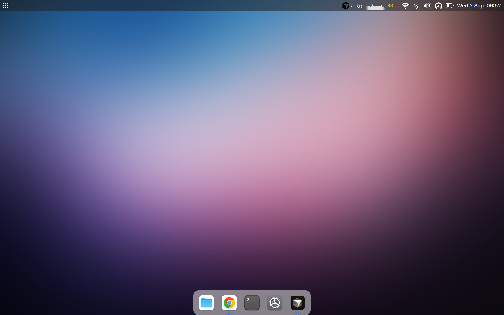
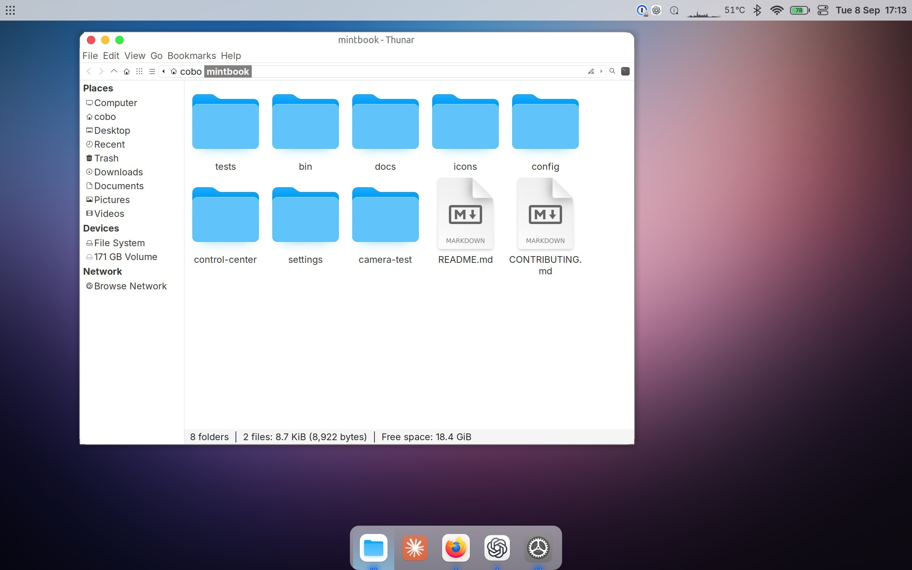
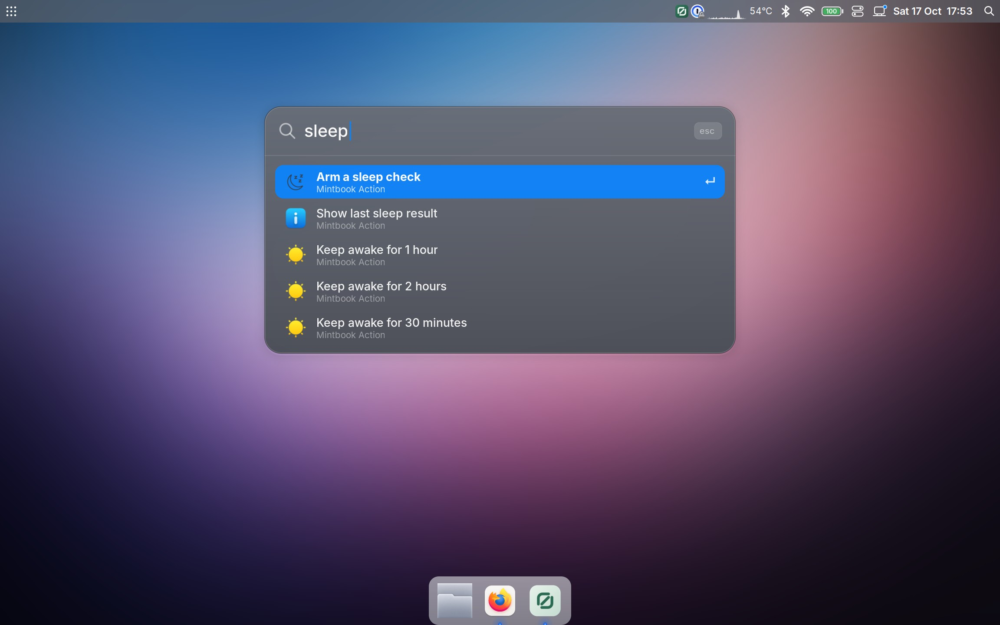
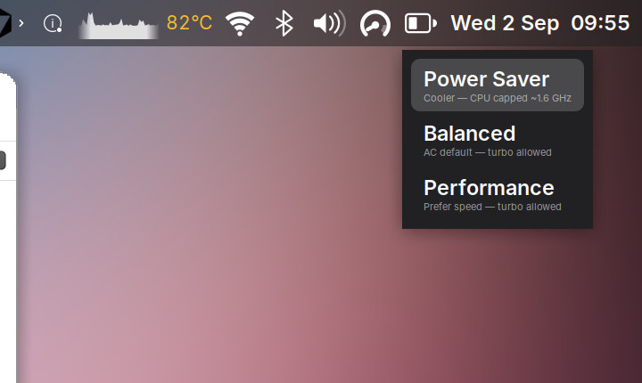

# mintbook

The 12-inch MacBook, on Linux Mint.

Looks like macOS. Works like it should.

<p align="center">
  
</p>

MacBook8,1 · Early 2015 · fanless Core M · 2304×1440
Linux Mint 22.3 · XFCE · kernel 7.0
macOS is still on the disk. OpenCore chooses what boots.

## The look

No Apple logo. No blur. A 52px glass bar, a dock, and Cmd+Space.

<p align="center">
  
  &nbsp;
  
</p>

<p align="center">
  
</p>

Cmd+Shift+3 takes a screenshot. On battery it stays cool. Plug in, and it opens up.

The wiring: [desktop](docs/desktop.md) · [display](docs/display.md)

## Hardware

Wi-Fi, speakers, headphones, camera, Bluetooth, keyboard, trackpad.

Speakers, camera, and Bluetooth want kernel **7.0**. **6.14** is the fallback if 7.0 will not boot — silent speakers, but it boots. OpenCore is the picker. GRUB is not.

Sleep is the open one: `applespi` does not survive S3, so every wake used to come
back with a dead keyboard and trackpad. A resume hook now rebinds it — written,
wired in, **not yet confirmed on a real wake**. See [input](docs/input.md).

`bin/hw-report` is live. Read-only. No sudo.

`bin/service-trim --check` lists the services this machine has no hardware or
no use for, and why. It needs no root and changes nothing until you run it
without `--check`.

After a kernel update, run `bin/doctor`. It checks every piece this machine needs —
firmware, DKMS modules, the DSDT override, udev and systemd units, the panel — and
tells you which one an update took away.

[Hardware](docs/hardware.md) · [Input](docs/input.md) · [Audio](docs/audio.md) · [Camera](docs/camera.md) · [Bluetooth](docs/bluetooth.md) · [Boot](docs/boot.md)

## Before you touch it

```bash
sudo timeshift --create --comments "before <change>"
```

`bin/revert-mac-theme` puts the original XFCE desktop back.

Every install script prints its own undo. So does `bin/tune-install`.

The docs record what was tried, and what was not.
