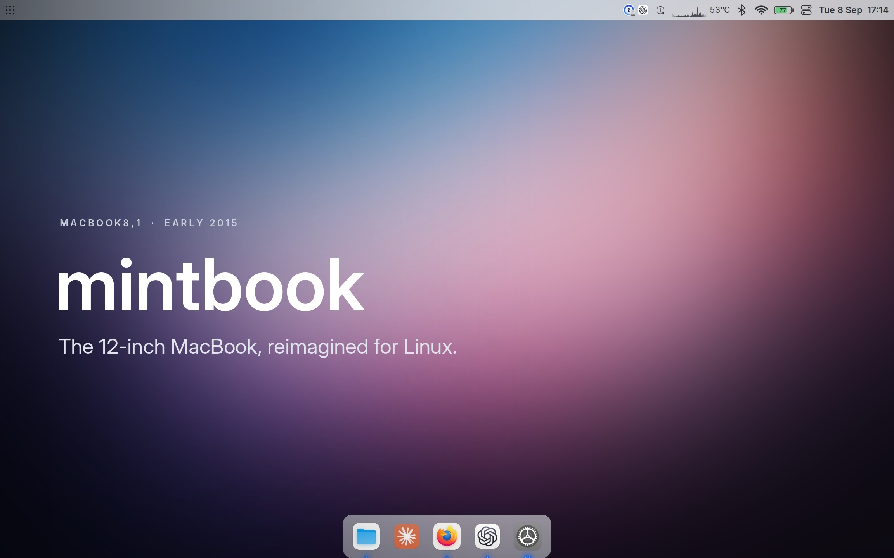
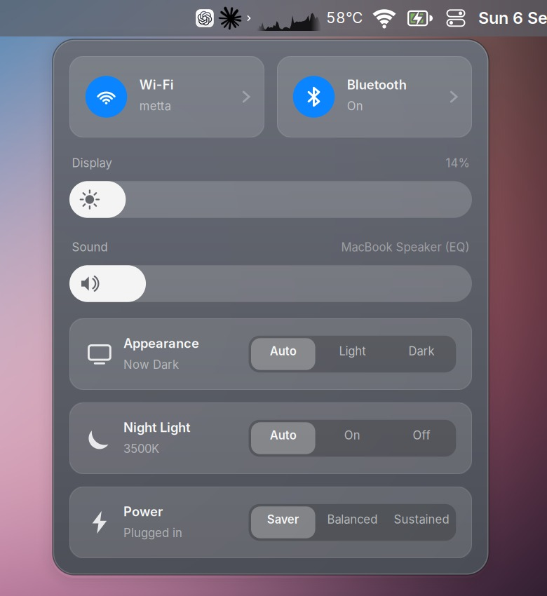
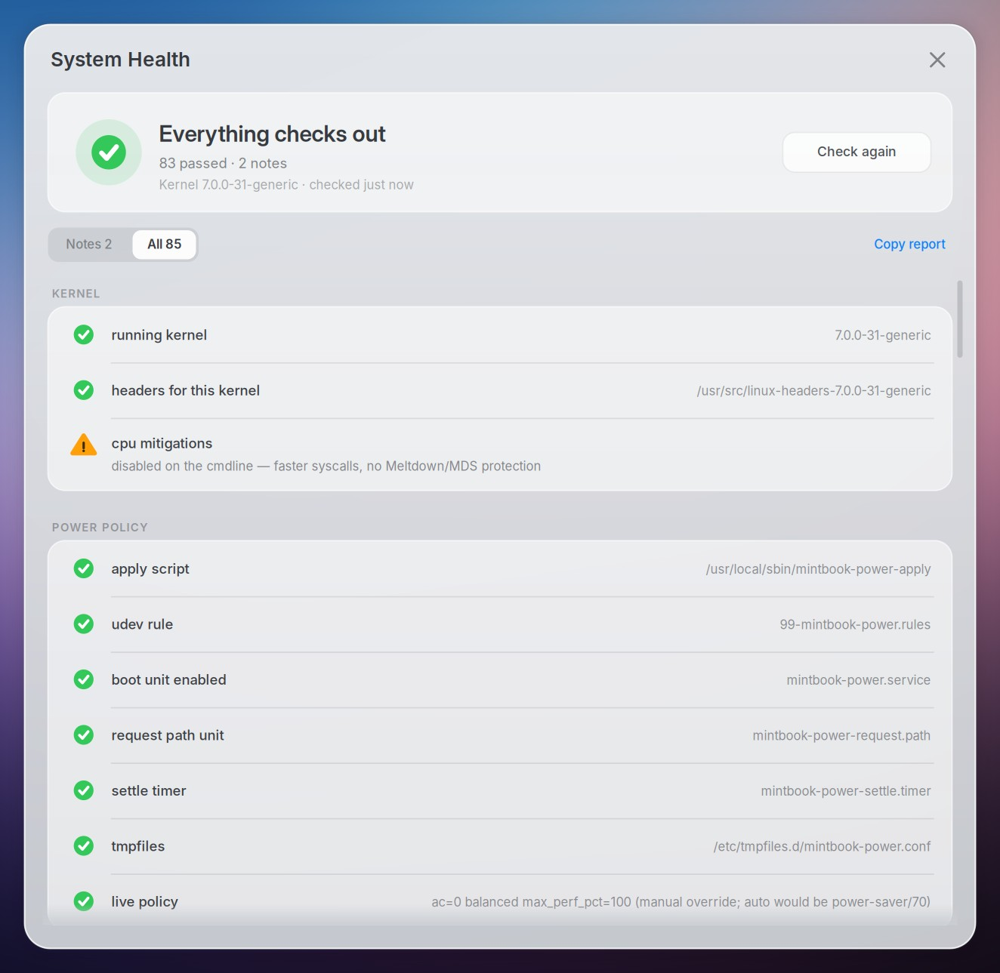

<p align="center">
  
</p>

<p align="center">
  <strong>MacBook8,1</strong> · Early 2015 · fanless Core M · 2304 × 1440<br>
  Linux Mint 22.3 · XFCE · kernel 7.0
</p>

One machine, documented: the desktop, the hardware fixes, and the measurements that make a 2015 MacBook worth carrying. A reference, not a distribution. Take what is useful.

## It feels like it belongs.

No Apple logo. No blur. A crisp glass bar, a dock, and the controls you reach for every day.

<p align="center">
  
</p>

<p align="center">
  <kbd>⌘</kbd> <kbd>Space</kbd> for everything.<br>
  <kbd>⌘</kbd> <kbd>←</kbd> <kbd>→</kbd> to place windows.<br>
  <kbd>⌘</kbd> <kbd>⇧</kbd> <kbd>3</kbd> for a screenshot.
</p>

The login screen wears the same theme, font and wallpaper. It is also the lock screen.

Volume, brightness and keyboard backlight step through the same glass pill, then leave.

## Everything you need. Nothing you don't.

The bar shows what matters: performance, temperature, connectivity, battery, time. Everything it controls lives in one place.

<p align="center">
  
</p>

Wi-Fi, Bluetooth, battery and CPU open straight from the bar. Updates appear only when there are updates.

Eleven small executables behind it all. No daemon.

## Send it to the machine next to you.

Drag a file onto the Mintdrop icon. Pick the phone in your pocket. It lands.

<p align="center">
  <picture>
    <source media="(prefers-color-scheme: dark)" srcset="docs/images/mintdrop-sheet-dark.png">
    
  </picture>
</p>

Real Quick Share to an unmodified Android phone, with nothing installed on it. No cloud. No cable.

No daemon: the kernel holds the socket, and a receiver exists only while a file is moving.

Every arrival asks first. The default answer is no.

## Tuned by evidence.

The hardware work is the point. Wi-Fi, speakers, headphones, camera, Bluetooth, keyboard and trackpad work. Suspend comes back. Hibernation survives a night unplugged.

| | before | after |
|---|---:|---:|
| Raw `getpid` syscall | 720 ns | **127 ns** |
| The status bar | 20.4% | **5.6%** of one core |
| `panel-power` | 357 ms | **33 ms** |

CPU mitigations off is a security trade with a number attached, not a free win.

The status bar was the most expensive software on the machine, and it drew six glyphs. `panel-power` started a Python interpreter to fork a second one.

`bin/doctor` re-checks every fragile piece. Read-only. No sudo.

<p align="center">
  
</p>

[The measurements](docs/performance.md) · [The hardware](docs/hardware.md) · [How hibernation was found](docs/hibernate.md)

## Use it on another account or machine

Start with [the setup guide](docs/setup.md) and `bin/setup-check`. Each account
needs its own configuration; the desktop release manager migrates an existing
setup, and hardware changes need a review for the target machine.

## Everything, documented.

| | |
|---|---|
| **Desktop** | [Look and behavior](docs/desktop.md) · [Control Center](docs/control-center.md) · [Updates](docs/updates.md) · [HiDPI](docs/display.md) · [Login](docs/login.md) |
| **Daily** | [Shortcuts and search](docs/daily.md) · [Battery](docs/battery.md) · [Video](docs/video.md) · [Nearby sharing](docs/mintdrop.md) |
| **Hardware** | [Input and sleep](docs/input.md) · [Hibernation](docs/hibernate.md) · [Audio](docs/audio.md) · [Camera](docs/camera.md) · [Bluetooth](docs/bluetooth.md) |
| **System** | [Boot and kernels](docs/boot.md) · [App performance](docs/app-performance.md) · [Top-bar review](docs/top-bar-review.md) · [Implementation](CONTRIBUTING.md) |

macOS remains on the disk. OpenCore chooses which system boots; GRUB does not. Kernel 6.14 remains a bootable fallback; speakers, camera and Bluetooth need kernel 7.0.

## Make a change. Keep a way back.

```bash
sudo timeshift --create --comments "before <change>"
```

Every installer prints its own undo. `bin/revert-mac-theme` restores the original XFCE desktop.

Nothing here asks you to trust a tweak you cannot inspect, or keep a change you cannot undo.

## License and upstream work

Mintbook is [MIT licensed](LICENSE). Adapted upstream sources and their exact revisions are in [`vendor/`](vendor/README.md) and [`THIRD_PARTY_NOTICES.md`](THIRD_PARTY_NOTICES.md).

<p align="center"><sub>One MacBook8,1. Still worth carrying.</sub></p>
