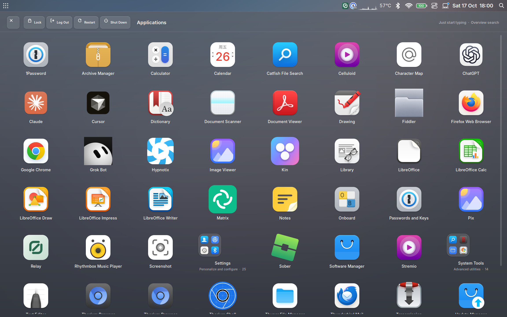
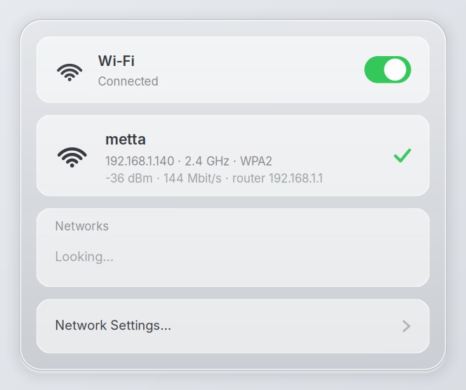
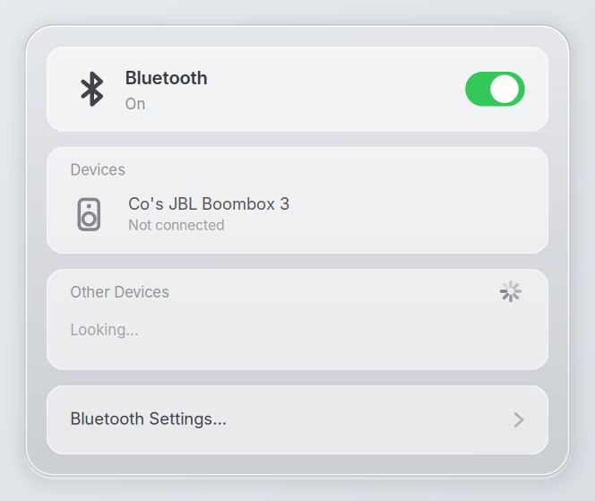
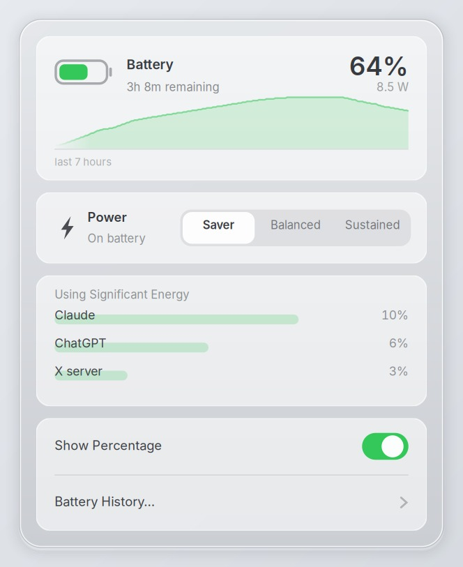

<div align="center">

# mintbook

### The 12-inch MacBook. Reimagined for Linux.

Quiet by design. Familiar at first glance. Built for the hardware underneath.

</div>

<p align="center">
  
</p>

<p align="center">
  <strong>MacBook8,1 · Early 2015 · fanless Core M · 2304 × 1440</strong><br>
  Linux Mint 22.3 · XFCE · kernel 7.0
</p>

## Start with Overview.

Mintbook turns the 12-inch MacBook into a focused Linux machine—without turning
Linux into a macOS costume. No Apple logo. No blur. Just a crisp glass bar, a
dock, and the controls you reach for every day.

Click the search icon at the far right of the bar—or press **Cmd+Space**.
Overview finds applications and system actions together, in one fast surface.

<p align="center">
  
  &nbsp;
  
</p>

**Show All Applications** opens a full-screen grid built for the display. Start
typing and your first keystroke flows straight into Overview. No second search.
No starting over.

<p align="center">
  
</p>

**Cmd+Left/Right** places windows. **Cmd+Shift+3** takes a screenshot. The
familiar gestures are simply there.

## Everything you need. Nothing you don't.

The bar shows what matters: performance, temperature, connectivity, battery,
and time. Everything it controls lives in one place.

<p align="center">
  
</p>

Control Center is fast, keyboard-friendly, and intentionally small. Behind it
are eleven simple executables—not a permanent background service. Adding a tile
takes about twelve lines.

Wi-Fi, Bluetooth, and battery open directly from the bar. Updates appear only
when updates exist, with apt and Flatpak together in one clean list.

<p align="center">
  
  &nbsp;
  
  &nbsp;
  
</p>

## Tuned by evidence.

This is more than a desktop theme. It is the hardware work that makes this
particular MacBook worth using again.

- Wi-Fi, speakers, headphones, camera, Bluetooth, keyboard, and trackpad work.
- Battery mode stays cool; external power unlocks short bursts of performance.
- Suspend uses the mode that reliably brings the keyboard and trackpad back.
- Firefox hardware-decodes H.264 for smooth, efficient video.
- `bin/doctor` checks the fragile pieces after every kernel change.

Every tuning decision is measured, documented, and reversible. The surprises
are recorded too—including the popular tweaks that made no difference.

[See the measurements](docs/performance.md) · [See how fast it feels](docs/feel.md) · [See hardware status](docs/hardware.md)

## Built all the way through.

| | |
|---|---|
| **Desktop** | [Look and behavior](docs/desktop.md) · [Control Center](docs/control-center.md) · [Software updates](docs/updates.md) · [HiDPI display](docs/display.md) |
| **Daily use** | [Shortcuts and search](docs/daily.md) · [Battery](docs/battery.md) · [Video](docs/video.md) |
| **Hardware** | [Input and sleep](docs/input.md) · [Audio](docs/audio.md) · [Camera](docs/camera.md) · [Bluetooth](docs/bluetooth.md) |
| **System** | [Boot and kernels](docs/boot.md) · [App performance](docs/app-performance.md) · [Implementation guide](CONTRIBUTING.md) |

macOS remains on the disk. OpenCore chooses which system boots; GRUB does not.
Kernel 6.14 remains a bootable fallback, though speakers, camera, and Bluetooth
require kernel 7.0 on this machine.

## Make a change. Keep a way back.

Before any system-level change:

```bash
sudo timeshift --create --comments "before <change>"
```

Installers print their own undo instructions. `bin/overview-install` adds the
Overview bar icon and shortcut; its `--revert` removes the icon while preserving
the established shortcut. Daily conveniences can be added or removed with
`bin/daily-install` and `bin/daily-install --revert`. The original XFCE desktop
can always be restored with `bin/revert-mac-theme`.

Nothing here asks you to trust a tweak you cannot inspect—or keep a change you
cannot undo.

## License and upstream work

Mintbook is available under the [MIT License](LICENSE). Small upstream sources
that Mintbook directly adapts are preserved under [`vendor/`](vendor/README.md),
with their original licenses and exact source revisions listed in
[`THIRD_PARTY_NOTICES.md`](THIRD_PARTY_NOTICES.md).
