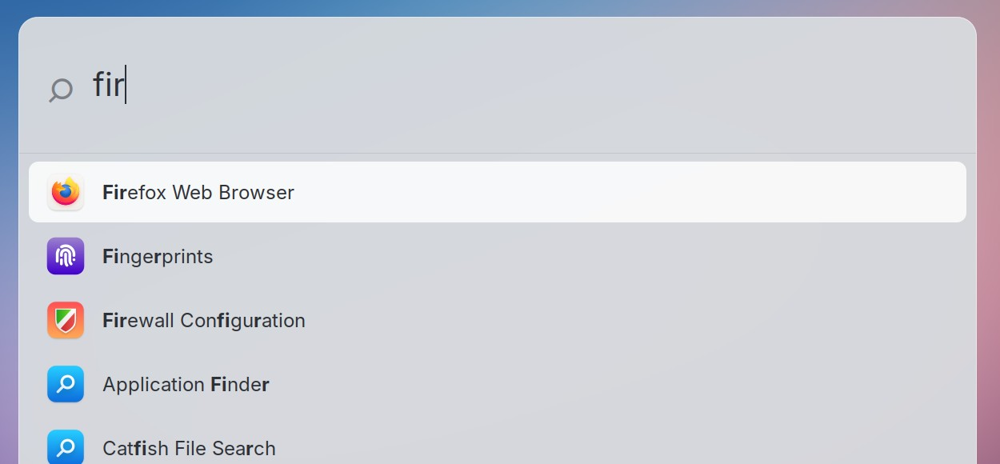
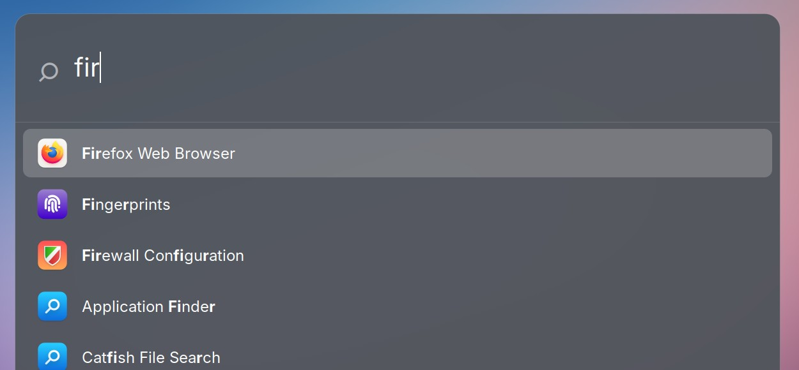

# Desktop — the macOS look

> 2026-09-07: keyboard navigation and daily conveniences are documented in
> [daily.md](daily.md). Earlier measurements below retain their original scope.

Making XFCE on this machine look and behave like macOS: the top bar, the dock,
Overview, the window manager and the panel indicators.

Scaling and DPI are **not** here — see [display.md](display.md).

---

## User preferences (stated explicitly)

- **No Apple logo anywhere.** The macOS look is wanted, the branding is not.
  Note WhiteSur's `start-here-symbolic` *is* an Apple logo despite the neutral name —
  the panel button uses Adwaita's `view-app-grid-symbolic` instead.
- **No blur.** Translucency only. Real blur (picom `dual_kawase`) was offered and
  declined on performance grounds. There is no picom; xfwm4's own compositor does the
  translucency at no extra process cost.
- **Keybindings: minimal.** Full Mac-style remapping (Toshy) was offered and declined.
  Only the Super key was freed and Cmd+Space bound. Copy/paste stays on Ctrl.
- **The top bar must stay thin.** 52px. A 64px bar was tested and rejected.

---

## What is installed

From the Mint repos:

```
plank rofi xdotool sassc libglib2.0-dev-bin libxml2-utils fonts-inter
xfce4-cpugraph-plugin xfce4-sensors-plugin xfce4-genmon-plugin
lm-sensors gnome-system-monitor btop redshift
```

From GitHub (cloned to `~/src/`):

- `vinceliuice/WhiteSur-gtk-theme` → installed to `~/.themes` as
  `WhiteSur-Light`, `-Dark`, plus `-hdpi` / `-xhdpi` variants
- `vinceliuice/WhiteSur-icon-theme` → installed to `~/.icons` as `WhiteSur-light`

Install command used for the GTK theme (`-o normal` is the translucent variant —
this is what provides the "glass" look without a blur pass):

```bash
cd ~/src/WhiteSur-gtk-theme
TERM=xterm-256color ./install.sh -o normal -c light -c dark -a normal -t default -d ~/.themes
```

> `TERM` must be set or the installer dies silently. It calls `setterm`, which fails
> when `$TERM` is unset, and the script hides stderr in `/tmp/WhiteSur.lock/error_log.txt`
> and deletes that directory on exit. It exits 1 with no visible message.

`xfce4-sensors-plugin` is installed but **unused** — see Gotchas.

---

## Current configuration

### Shared glass palette

[`config/theme/mintbook-glass.ini`](../config/theme/mintbook-glass.ini) is the
canonical source for the pearl surface colour: `#E5E7EA` at the lit edge to
`#CACDD2` below it. It also holds the darker, icon-safe system-bar derivative.
Each renderer has its own format, so the palette is translated rather than
shared as literal CSS: Firefox uses `rgb()` values, Plank uses `R;;G;;B;;A`,
XFCE panel stores normalized RGBA doubles, rofi wants `rgba(r, g, b, n%)` in
rasi, and the Control Center wants 0-255 tuples in Python. Five formats, one
set of numbers, translated by hand at each end.

### System-chrome appearance mode

Appearance is the `40-appearance` tile in the Control Center: **Auto**,
**Light**, or **Dark**. Auto is the default and checks Redshift's period once a
minute, so the panel changes at the same sunset/sunrise boundary as Night Light
without starting another daemon or altering Night Light's own mode. That
once-a-minute check is now `bin/panel-control`'s only job — the Control Center
indicator inherited it from the retired `genmon-24` sun/moon icon, which is why
a bar icon that never changes still has an update period at all.

[`bin/appearance-mode`](../bin/appearance-mode) applies the surface, panel-only
foreground CSS, the Overview palette and regenerated Mintbook status icons
together. It writes the
desired mode to `~/.config/mintbook/appearance.mode`; `auto` remains there even
when the currently applied surface is Light or Dark. The custom Wi-Fi,
Bluetooth, power, Night Light, CPU, and temperature indicators therefore switch
with the bar, and so do the Control Center and Overview.

> **The CPU sparkline did not, until 2026-09-06,** even though this said it
> did. It was black in both appearances — right by accident on pearl, wrong on
> slate. `system-chrome.env` is shell, and it was written with `printf %q`,
> which stores `#ffffff` as `\#ffffff`. Sourcing it gives the value back
> intact, so `bin/panel-temp` was always correct; `bin/panel-cpu` reads the
> line as text, and `fill="\#ffffff"` is not a colour, so librsvg dropped it
> and fell back to black. The file is single-quoted now instead of escaped, so
> both ways of reading it agree, and `panel-cpu` strips a stray backslash and
> range-checks the hex anyway. Branded or
third-party tray icons retain the appearance supplied by their own app—forcing
those through one colour would destroy their identity or require per-app
patches.

> **The mode file used to have a race, fixed 2026-09-06.** `auto` worked by
> writing `auto`, calling itself with `light` or `dark` — which wrote *that* to
> the same file — and writing `auto` back afterwards. Anything that read the
> file inside that window latched the transient value, and since
> `bin/panel-control` runs `--refresh` every 60 s there is a reader on a timer.
> One evening `auto` quietly became a permanent `light` and stopped following
> the sun. The child now inherits `MINTBOOK_APPEARANCE_MODE=auto` and records
> that instead of the surface it is applying, so the file only ever holds what
> the user chose.

### Top bar (xfce4-panel, `panel-1`)

| Setting | Value |
|---|---|
| `position` | `p=6;x=0;y=0` (top, full width — `p=6` is what makes it *snap*, see Gotchas) |
| `size` | 52 |
| `icon-size` | 36 |
| `background-style` | 1 (solid colour) |
| `background-rgba` | Mode-managed: pearl light (`0.843, 0.855, 0.871, 0.859`) or slate dark (`0.357, 0.376, 0.412, 0.702`) |

Plugin order (`plugin-ids`), left to right:

| id | plugin | notes |
|---|---|---|
| 1 | launcher | 3×3 applications button → fullscreen app grid |
| 7 | separator | `expand=true` — pushes everything right |
| 8 | systray | "the rest" — Claude, 1Password, Chrome. No collapse arrow: nothing is hidden (see Bluetooth below) |
| 10 | xapp-status-plugin | mintUpdate, only when updates are available |
| 19 | genmon | CPU sparkline |
| 17 | genmon | CPU temperature |
| 21 | genmon | Bluetooth — click opens [`bin/bt-menu`](../bin/bt-menu) |
| 18 | genmon | Wi-Fi — click opens [`bin/wifi-menu`](../bin/wifi-menu) |
| 26 | genmon | battery — click opens [`bin/battery-menu`](../bin/battery-menu); see [battery.md](battery.md) |
| 25 | genmon | **Control Center** — see [control-center.md](control-center.md) |
| 13 | clock | ` %a %-d %b  %H:%M  `, Inter 11, `digital-layout=3` (time only) |
| 27 | genmon | **Overview** — click opens app and action search; hover teaches `Super + Space` |

Bar tooltips follow Overview: the widget name, one short status line when it
earns the hover (SSID, charge remaining, connected devices, CPU percent), and
the shortcut that opens the menu when there is one. Click-only menus do not
say "click". The rest of the story is in the popup.

Right-to-left: **Overview, date/time, Control Center, battery, wifi, bluetooth,
temperature, CPU, then the rest.** This follows the macOS convention — the
search affordance is furthest right, then the clock, Control Center, battery, Wi-Fi and
Bluetooth. Informational items (temp,
CPU) sit inboard of the system status group, and anything unrecognised
accumulates right-to-left from the far left of the group. mintUpdate's own icon
appears in the xapp group (plugin-10) only when there are updates.

**Power profile (22), night light (23), appearance (24) and volume (12) are no
longer on the bar.** They are tiles in the Control Center, which is one icon
and one click instead of four indicators polling all day. The rule the split
follows is that a reading stays on the bar and a switch moves behind the click;
the sections below describe what those indicators did and still apply to the
tiles, which use the same backends. `bin/control-install --revert` puts every
one of them back.

> **Bluetooth (21) went with them on 2026-09-06 and came back on 2026-09-07.**
> Under the same rule, not around it: once the icon could answer *is the
> speaker connected* without a click, it stopped being a switch that happened
> to be sitting in the open and became a reading, which is what Wi-Fi always
> was. The `20-bluetooth` tile stays where it is —
> [`bin/bt-menu`](../bin/bt-menu) drives that plugin's `set` verb rather than
> `bluetoothctl`, so the switch in the popup and the tile in the Control
> Center cannot disagree. `bin/bt-panel-install --revert` takes the icon back
> off and leaves the tile.

**Reordering panel items:** XFCE has no macOS-style hold-a-key-and-drag. The
equivalents are right-click any item → **Move** (then drag it along the bar), or
right-click → Panel → Panel Preferences → **Items** tab, which is a drag-to-reorder
list. Anything in `plugin-ids` can also just be reordered in xfconf, which is what
was done here.

### Applications grid (`plugin-1`, launcher)

The 3×3 button launches [`bin/app-grid`](../bin/app-grid), an undecorated GTK
cover sized to the monitor work area: `y=52`, so the system bar remains visible
and usable. It reads the desktop application index through Gio and shows every
visible app in a dense, borderless 12-column grid with 96px icons. The
background is the same cheap glass recipe as the Control Center: an ARGB window
with a static translucent gradient and no backdrop blur pass.

The top-left controls stay close to the panel button: **Lock**, **Log Out**,
**Restart**, and **Shut Down**. Their line icons are drawn in the active
light/dark foreground instead of using WhiteSur's fixed black symbolic SVGs.
Session-ending actions use a confirmation dialog; Escape, Super, or the close
button dismisses the grid.

Any printable key hides the grid and starts the existing centered Overview
launcher with that first character already in its query. The panel button opens
the grid; Super stays inert so it cannot also fire during Super+Space, which
continues to open Overview directly. [`bin/app-grid-install`](../bin/app-grid-install)
installs the launcher; `app-grid-install --revert` restores Whisker.

### CPU sparkline (`plugin-19`, genmon)

Runs [`bin/panel-cpu`](../bin/panel-cpu), which renders an SVG sparkline to
`~/.cache/mintbook/cpu.svg` every 2s, in the panel foreground colour of the
current appearance — white on slate, `#2d3036` on pearl, at 0.82 opacity.

`xfce4-cpugraph-plugin` was used first and then **removed**. It draws hard vertical
edges with no way to soften them, and its tooltip is not controllable. The genmon
version gives:

- **Faded leading/trailing edges** via a `<linearGradient>` inside a `<mask>`, so the
  trace dissolves into the bar instead of ending abruptly. Verified in the rendered
  pixbuf: alpha ramps 0 → 209 → 8 across the width.
- **A tooltip of `CPU` and the current percentage.** The process table used to live
  here; it moved into the menu, which is where a list of names can actually be
  used. Same shape as Overview: the name, then one short fact.
- **Click opens the CPU menu.** [`bin/cpu-menu`](../bin/cpu-menu) is a glass popup
  like Wi-Fi / battery / System. `Activity Monitor…` in the footer still opens
  `gnome-system-monitor`. Without the menu installed, the click falls back to
  System Monitor on its own — the same trick as `panel-wifi`.
- **Hover colours it.** The trace becomes the menu's stacked bands, in the same
  icon colours, and goes back to one flat colour when the pointer leaves. See
  below — genmon has no hover to offer, so this is built out of the plugin's
  own X window.

State lives in `~/.cache/mintbook/`, written via a temp file and `os.replace`
so a half-written file is never read. It is **four** files, and the split is the
point:

- `cpu.state` — previous jiffies, the history and the tick counter. Rewritten
  every tick.
- `cpu.procs` — the per-process time table and the `/proc/stat` totals it was
  taken against. ~5.6 KB, rewritten every **third** tick (`PROC_EVERY`).
- `cpu.stack` — JSONL samples of the top 8 processes' *share of the machine*,
  RSS, and the read/write bytes they did in that interval. The menu paints this
  as a stacked chart. Rewritten with the process table, not every tick.
- `cpu.io` — the previous `/proc/<pid>/io` counters for those top pids, so the
  next sample can store a delta instead of a since-start flood.

Hover adds two more that are flags rather than state: `cpu.hover` exists only
while the pointer is on the widget, and `cpu-hover.pid` holds the two watchers
and the panel wrapper they are watching. `app-colors.json` is the icon-colour
cache, described under the menu.

The sparkline reads two numbers out of `/proc/stat`, which is cheap. The `/proc`
walk that feeds the menu is not: it opens `/proc/<pid>/stat` for every process
on the machine, and at 2 s that was 159 s of CPU in a two-hour session. The
walk now runs every third tick. Because the process delta is measured against
the total stored *next to the table* rather than against the previous tick, the
percentages stay correct over the longer interval.

I/O is not a second walk of `/proc`. After the ranking, `panel-cpu` opens
`/proc/<pid>/io` for the eight processes already on the chart. A pid that was
not in the previous top set contributes 0 this sample rather than dumping its
lifetime counters onto the first point of the line.

> GTK tooltips are not interactive, so a *button* inside the hover is not possible —
> hence click-to-open. Task Manager remains on its existing **Ctrl+Shift+Esc** binding.

### Hover on the sparkline ([`bin/cpu-hover`](../bin/cpu-hover))

**Since 2026-09-09.** Put the pointer on the sparkline and the trace becomes
the stack: the same bands as the menu's chart, in the same icon colours, over
roughly the same ~96 s the flat trace covers. Take the pointer away and it is
one colour again. The bar at rest is still a reading, not a story.

genmon has no hover to give — an image and a text tooltip is the whole
contract. But every xfce4-panel plugin here runs in its own `wrapper-2.0`
process with its own X window, and `EnterNotify`/`LeaveNotify` are not
exclusive masks: another client may select them on a window it does not own.
`xdotool behave` is that client, already installed for the menu's anchor, and
it costs nothing but its ~3 MB while it sits blocked on the X socket.

It takes **two** xdotool processes, one per event. `behave`'s `exec` takes the
entire rest of the command line, so chaining a second `behave` after it does
not fail — it quietly becomes arguments to the first handler. Enter fires,
leave never does, and the bar stays coloured. That looked like it worked in a
first test only because the enter handler was `touch`ing the file the leave
handler was supposed to.

> **`--plugin-event=plugin-19:refresh:bool:true` has never done anything.**
> `bin/cpu-install` has sent it after every install since the sparkline
> landed, and `xfce4-panel` matches on the plugin **name**, not on
> `plugin-<id>`: the event was delivered to no plugin and returned FALSE every
> time. The picture only ever changed on genmon's next 2 s tick, which is also
> why the old comment there said it would. `genmon:refresh:bool:true` does
> work — and re-runs all **twelve** genmon widgets on this bar, twelve python
> starts for one hover.

So the repaint goes to one plugin instead. Each wrapper has its own object on
the session bus, and the `RemoteEvent` signal the panel sends it is matched by
path, not by sender — emitting it directly reaches plugin 19 alone in ~50 ms
and leaves the other eleven asleep. That is a panel internal, so `nudge()`
watches for the repaint it should have caused and falls back to the name-wide
event if it never comes. Pointer to colour is ~300 ms end to end.

`panel-cpu` then has to tell a repaint from a tick: a run that arrives within
`MIN_TICK` of the last state write renders and prints, and does not sample.
Measuring a 100 ms interval would put a spike in the history and walk `/proc`
a tick early, so a hover would leave a mark on the graph it was drawing.

The watchers are started and restarted by `panel-cpu` itself — one stat, one
read and three `/proc` lookups on a tick it was already running — so there is
no autostart entry to install and nothing to clean up. The pidfile names the
panel wrapper as well as the watchers, because a panel restart leaves them
alive and pointed at a window that no longer exists; when any of the three is
gone the survivors are killed and the pair is started again. A failed attempt
is not retried for 30 s, so a panel that is still coming up is not hunted once
every two seconds.

> **The silhouette changes, not just the colour.** The bands come from the
> 6 s process history, not the 2 s trace, so the hovered line is smoother and
> its spikes are lower — hovering redraws the line as well as colouring it.
> A watcher that dies mid-hover also leaves the bar coloured until `panel-cpu`
> notices, which is up to 30 s. And the colours come from the cache: the first
> hover of an app nobody has looked at yet costs one icon walk, done in
> `cpu-hover` rather than in `panel-cpu`, which must never import Gtk.

### CPU menu ([`bin/cpu-menu`](../bin/cpu-menu))

**Since 2026-09-09.** Clicking the sparkline opens a glass popup, not a window.
Same construction as [`bin/battery-menu`](../bin/battery-menu) and for the same
reasons ([control-center.md](control-center.md)): cairo on one override-redirect
window, one `DrawingArea`, a list of rows.

The bar is still the reading. The menu is the story: which processes made the
line, in colour, over the last few minutes. Hover a row and its band lights up
in the chart; click it for a deeper look at that pid — live cores, RSS, whether
the bytes it is moving are coming from disk or from cache, the files it has
open, its command line and working directory. Escape or the back chevron
returns to the list. `Activity Monitor…` is still there for the full table.

**Colours come from each app's own icon.** Firefox's band is Firefox orange,
not whatever a hash of `firefox-bin` came to. `bin/mintbook_appcolor.py` walks
`comm` → `.desktop` → `Icon=` → the icon theme, renders that file at 64px, and
lets every one of the 4096 pixels vote for a 15° hue bucket weighted by
saturation × value — a full pass, not a random sample, because it costs ~10 ms
and is repeatable. Only the winning hue and its mean saturation are cached, in
`~/.cache/mintbook/app-colors.json`; lightness belongs to the *appearance*, so
one base paints a darker orange on pearl and a lighter one on slate and
switching appearance re-reads no icons at all.

The walk runs **after the first frame**, in an idle callback. Six icons is
~100 ms, which is half the popup's time to screen; an app that has never been
seen keeps a fallback colour for one frame and is decoded once, ever. Hits and
misses are both written back, and the whole file is dropped when an
applications directory or the icon theme changes — which is what makes
remembering a miss safe when an app is installed later.

> **Plenty of apps have no colour to take.** ChatGPT, Cursor and most terminals
> ship black-and-white marks. The sampler refuses them — a winning hue under
> 0.35 mean saturation, or under a tenth of the visible pixels carrying any
> colour at all, is antialiasing, not a brand — and those names fall back to
> the old hashed palette, which is distinct but arbitrary. A grey band would be
> honest and invisible. Two apps whose icons genuinely share a hue are not
> spread apart either; the second only moves a shade along, and the legend dot,
> the name and the hover are the tiebreak.

The chart is stacked as *share of the machine*, and **the list now reads in
that same unit**: `26%`, not `1.0`. Cores are the Activity Monitor number and
answer "is this pegging a core?", but at one decimal every quiet process
rounded to the same `0.0`, and a bare `1.0` reads like a score out of ten. Rows
sort by that percentage, keep a tenth below 10%, and print cores in the
sub-line only when a process is actually holding one — and under the percentage
in the detail view. Pressure stall (`/proc/pressure`) and swap join the
subtitle only when they are actually happening.

Install with [`bin/cpu-install`](../bin/cpu-install); `--revert` deletes
`~/.local/bin/cpu-menu` and `cpu-hover`, stops the watchers, and `panel-cpu`
falls back to `gnome-system-monitor` on its own and to a plain trace on hover. `bin/doctor` checks for it, and says nothing when it is not installed.

The helpers live in [`bin/mintbook_cpu.py`](../bin/mintbook_cpu.py) so the
collector and the popup share one format, and so the format can be tested
without opening a Gtk window. The icon colours are separate, in
[`bin/mintbook_appcolor.py`](../bin/mintbook_appcolor.py), which imports Gtk
*inside* the two functions that need it: `panel-cpu` runs every two seconds and
must never pay for that import, and the sampler is then testable on a buffer of
bytes with no display at all (`tests/test_app_colors.py`).

### Temperature (`plugin-17`, genmon)

genmon does **not** use xfconf — it reads `~/.config/xfce4/panel/genmon-17.rc`.
It runs [`bin/panel-temp`](../bin/panel-temp), which finds `coretemp` **by name** (hwmon
numbering is not stable across boots), prints the package temp, and colours it
white / amber at 80°C / red at 90°C. The tooltip is `Temperature` plus the
sensors that are not already the label (SSD, PCH, battery) on one line.

The label is **fixed-width**: the number is padded to three characters with U+2007
FIGURE SPACE (exactly one digit wide) and rendered with `font_features="tnum"`, so
the reading never changes width as the value moves between 2 and 3 digits. Verified
at a constant 38px for values from 7 to 100. Font is Inter 9.

The reading is **smoothed with an EMA** (alpha 0.35) held in
`~/.cache/mintbook/temp.state`. The raw sensor is instantaneous, and restarting the
panel is itself a CPU burst, so the reading used to jump high and then drift back over
~10s. State survives restarts, so the displayed value now eases rather than slamming.
The underlying heat was real — this smooths the presentation, it does not hide a
problem.

### Update manager (mintUpdate tray)

A first genmon replacement (`plugin-20`) was tried and reverted. Two independent
failures stacked:

1. The script read `~/.linuxmint/mintupdate/updates.json`, which stays `{"updates": {}}`
   even when Update Manager has a real list, so the genmon icon never switched to
   "pending" — it just sat there.
2. `gsettings set com.linuxmint.updates hide-systray true` does **not** hide the
   stock icon forever. The preference label is *"Only show a tray icon when updates
   are available or in case of errors"*. mintUpdate still calls `set_status(..., True)`
   whenever updates exist, so the old XApp icon appeared next to the dead genmon one
   as soon as there was something to install.

The current replacement does not read Mint's stale JSON. [`bin/updates-check`](../bin/updates-check)
imports Mint's own `checkAPT` backend, writes a small state file, and `plugin-20` reads
that file. [`bin/updates-install`](../bin/updates-install) also installs a `Hidden=true`
user autostart override for `mintupdate.desktop`, because `hide-systray` cannot prevent
the stock icon from returning when updates exist. The Update Manager application is
still installed and opens on demand from the custom popup; only its automatic session
tray process is disabled.

### Wi-Fi indicator (`plugin-18`, genmon)

Runs [`bin/panel-wifi`](../bin/panel-wifi), which reads link quality from
`/proc/net/wireless`, checks `/sys/class/net/<if>/carrier` for association, and
emits an `` pointing at a pre-rendered SVG.

**This exists to escape the 20px xapp cap.** genmon renders `` at the SVG's own
declared size, so these icons are 30px and match the speaker and battery. They are
generated by [`icons/generate-wifi-genmon.py`](../icons/generate-wifi-genmon.py) into
`~/.local/share/mintbook/wifi/`.

**The shape is the menu's, since 2026-09-07.** The generator used to draw three
filled annular wedges — square, chisel-cut ends — while
[`bin/wifi-menu`](../bin/wifi-menu)'s `wifi_glyph()` drew three *stroked* arcs
with round caps. Two different Wi-Fi icons, one of them nicer, on the same
machine. The generator now carries `wifi_glyph()`'s proportions directly: radii
`.16/.31/.46` of a box, stroke `.085`, dot `.055`, the arc from `π×1.22` to
`π×1.78`, and dim arcs at `.22` rather than `.35`. **Keep the two in step.**

The size is solved from the **width**, not the height. The menu's fan sweeps
101° against the wedge version's 84°, so matching them on height made the icon
20% wider than the one it replaced and it read as a size larger than the battery
next to it. Matched on width — 34px of glyph, the wedge version's own footprint
— it sits with the rest of the bar, and the extra vertical padding is how the
same glyph sits in the popup anyway.

**Associated is not online.** Since 2026-09-07 the icon also reads
NetworkManager's cached `Connectivity` property — `1` none, `2` behind a
captive portal, `3` limited, `4` full — and anything but `4` draws
`wifi-warn.svg`, which is the full fan with an exclamation beside it, and says
which in the tooltip. Three full bars while the uplink is dead is the icon
telling a confident lie.

That is the **property**, not `CheckConnectivity()`: the property is what NM
last decided and costs 15 ms, the method goes and asks the network. It takes
the tick from **~30 ms to ~48 ms**, 0.56% of a core to ~0.95%, measured
2026-09-07. `wifi-warn.svg` is 8px wider than the others, so the bar reflows
when it appears — which is the point of it.

These are **not** symbolic icons — genmon shows them as plain images, so GTK does no
recolouring and the fill is an explicit colour. `bin/appearance-mode` re-runs the
generator with `MINTBOOK_PANEL_FG` on every appearance change, and
[`bin/wifi-install`](../bin/wifi-install) reads the same value out of
`system-chrome.env`, so a fresh install on a light bar is not white-on-white.

**nm-applet is disabled** (`~/.config/autostart/nm-applet.desktop` with `Hidden=true`)
so it stops claiming an XApp slot. NetworkManager itself is untouched and connections
work normally — verified `connected:full` with working DNS after the change.

### Wi-Fi menu ([`bin/wifi-menu`](../bin/wifi-menu))

**Since 2026-09-07.** Clicking the bar icon opens a glass popup, not a window.
Same construction as [`bin/battery-menu`](../bin/battery-menu) and for the same
reasons ([control-center.md](control-center.md)): cairo on one override-redirect
window, one `DrawingArea`, a list of rows. `Network Settings…` in the footer still
opens `nm-connection-editor` for the things a popup should not try to be.

It shows the radio switch, the link you have (address, band, security, dBm, rate,
router) and the networks in range, one row per SSID rather than per BSS — a mesh
puts one name on five radios and the row kept is the one the card is associated
with, failing that the loudest. Known networks sort first and are drawn in the
semibold weight. Clicking a known or open network joins it; clicking an unknown
secured one opens a password pane.

> **This closes the nm-applet trade-off.** nm-applet was also NetworkManager's
> **secret agent**, and disabling it meant a new password-protected network had no
> password prompt — the note that used to be here said to use `nm-connection-editor`
> or `nmcli device wifi connect <ssid> --ask`. The menu's password pane is that
> prompt. To undo the whole thing instead: delete the autostart override and run
> `nm-applet &`.

Two timings decide the shape of the file. The cached scan (`nmcli … --rescan no`)
costs 90 ms and runs as a `Popen` *before* the GTK import, alongside the saved-profile,
radio and link reads — the window is on screen in **370–600 ms**, which is the battery
menu's number. An actual rescan costs **4.5 s**, so it runs in a thread and the row
set changes underneath: `rebuild()` re-sizes the window, which is free because the
popup hangs off the top bar and only ever grows downward.

The password field is drawn, not a `Gtk.Entry`. This display is at 168 dpi and
everything else in the popup is scaled by hand, so a themed GTK widget would have
been the only thing in it that did not match. It handles printable characters,
Backspace, `ctrl+u`, paste and Return. An override-redirect window is never given
focus by xfwm4, so the seat grab goes from `ALL_POINTING` to `ALL` while the pane is
open — without the keyboard in the grab the field takes no keys at all.

Install with [`bin/wifi-install`](../bin/wifi-install); `--revert` deletes
`~/.local/bin/wifi-menu` and `panel-wifi` falls back to `nm-connection-editor` on its
own. `bin/doctor` checks for it, and says nothing when it is not installed.

**The password goes on stdin, not on argv.** `nmcli … password <pw>` puts the
secret in the process's command line, where any local `ps` can read it for as
long as the join takes, and `nmcli` has no `--password-file`. It does have
`--ask`, which prompts — and its prompts are GNU readline, which reads a pipe as
happily as a terminal. So the menu runs `nmcli --ask device wifi connect <ssid>`
and writes the password to its stdin.

What was actually checked, 2026-09-07:

- `strings $(which nmcli)` has **no `/dev/tty`** anywhere in it, so stdin is the
  only stream it can be reading a secret from. (This was the real risk: a lot of
  tools read passwords from the controlling terminal and ignore a pipe.)
- `nmcli --ask connection add type wifi` was driven through **fifteen
  consecutive prompts from a pipe** — SSID, interface, four Wi-Fi optional
  settings, IPv4, IPv6 and proxy groups — taking piped values and bare newlines
  as defaults. `nmc_readline` reads a pipe.

What was **not** checked directly: the echo-off secret prompt itself. Reaching
it needs a live association against a secured AP, and the only ones in range
belong to this household. `nmcli --ask connection add` never prompts for a PSK —
it is not one of its optional-settings groups — so there is no radio-free path
to it. The inference is that `nmc_readline_echo_off()` is `tcsetattr` around the
same `nmc_readline`, and `tcsetattr` failing on a pipe leaves the read
unchanged. To close it for real, on a network you do not mind dropping for ten
seconds:

```
nmcli connection delete "<ssid>" && printf '%s\n' '<password>' \
  | nmcli --ask device wifi connect "<ssid>"
```

**Known limits, all cosmetic or noted rather than fixed:**

- **"Known" is matched on the profile name.** NetworkManager names a Wi-Fi profile
  after the SSID it was created from, and reading the real SSID out of a profile is
  one `nmcli` per profile. A profile that has since been renamed loses its bold and
  its sort position. Joining does not depend on this.
- **Hidden networks are not listed**, the same as macOS. There is no "Other
  Network…" to type one into, and no "Forget This Network" —
  `nm-connection-editor` is one click away for both.
- **A rate-limited rescan can come back empty.** `nmcli device wifi rescan`
  refuses one that follows another too closely, and then the list read hits an
  empty cache and the menu shows nothing. It retries once and says "Looking…"
  until it has, because an empty list is also sometimes just the truth.

### Bluetooth indicator (`plugin-21`, genmon)

> **Off the bar 2026-09-06, back on it 2026-09-07.** It was the `20-bluetooth`
> Control Center tile alone for a day; it is now both, and the click opens
> [`bin/bt-menu`](../bin/bt-menu) rather than `blueman-manager`.

Runs [`bin/panel-bt`](../bin/panel-bt), icons from
[`icons/generate-bt-genmon.py`](../icons/generate-bt-genmon.py).

Blueman's tray icon is a StatusNotifier item, so it lands in the systray plugin
(plugin-8) alongside Claude and **cannot** be placed on its own. Same constraint as
nm-applet / mintUpdate in xapp-status-plugin: one widget, one group. The genmon
indicator sits immediately left of Wi-Fi, which is where macOS puts it. Polls
BlueZ over D-Bus every 5s. Dim icon when powered off; full white when on;
tooltip lists connected devices.

**The icon does not change when a device connects**, and that is deliberate —
macOS's does not either, and at 34px the difference between "on" and "on with
something attached" is a distinction the glyph cannot carry. The tooltip names
the devices and the popup shows their battery; the icon answers on/off.

**What it costs (2026-09-07):** 17 ms of CPU per tick measured over 40 runs
(26 ms wall), at the 5 s poll — **0.34% of a core**. That is the whole reason
the reading is `dbus-send` piped through awk rather than anything that imports
`gi`; see the paragraph below.

It is a bash script that reads one `dbus-send` reply with awk. It used to be
Python importing `gi.repository`, and that import alone was 190 ms of the
script's 197 ms — essentially the whole cost was loading GObject introspection
in order to make a single call. "No adapter" is answered from
`/sys/class/bluetooth/hci*` before D-Bus is touched at all, which is also the
state this machine lands in when the SSDC regression eats hci0.

**blueman's own tray icon is switched off, not hidden** — *changed 2026-09-07*.
It used to be hidden via `/plugins/plugin-8/hidden-items = blueman`, and that
one entry was the entire reason the systray had a **collapse arrow** on it: the
arrow appears only when there is something behind it. With our icon on the bar,
blueman's was a second Bluetooth widget saying less, so it is no longer created:

```bash
gsettings set org.blueman.general plugin-list "['!StatusIcon', '!ShowConnected']"
```

`StatusIcon` is the blueman applet plugin that spawns the separate
`blueman-tray` process. **`ShowConnected` has to go with it** — it is the only
other plugin that declares `__depends__ = ["StatusIcon"]`, and blueman's
`PluginManager.__load_plugin()` loads a dependency whether or not it is in the
disable list, so disabling `StatusIcon` on its own leaves the tray running.
That was tried first and did nothing visible.

With nothing left to hide, `hidden-items` is removed and the arrow goes with
it. Both edits happen inside one panel stop in
[`bin/bt-panel-install`](../bin/bt-panel-install), because running plugins
write xfconf back on shutdown and a `hidden-items` written while the panel is
up is overwritten a second later.

**blueman-applet itself stays running** — it is the BlueZ pairing agent, which
is where [`bin/bt-menu`](../bin/bt-menu) sends any passkey dialog. `AuthAgent`
does not depend on `StatusIcon`, and this was checked rather than assumed:
`Register Agent` appears exactly once in `blueman-applet --loglevel debug`
both with the two plugins disabled and with `plugin-list` empty. The agent
object is on the *system* bus at `/org/bluez/agent/blueman` and the bus policy
denies introspection, so the log line is the check, not `busctl tree`.

`bin/bt-panel-install --revert` puts `plugin-list` back to empty, restarts the
applet so the tray returns, and writes `hidden-items = blueman` again — the
arrow comes back with it, which is where this started. `bin/doctor` warns if
either creeps back.

### Bluetooth menu ([`bin/bt-menu`](../bin/bt-menu))

**Since 2026-09-07.** Clicking the bar icon opens a glass popup, not a window.
Same construction as [`bin/wifi-menu`](../bin/wifi-menu) and
[`bin/battery-menu`](../bin/battery-menu), for the same reasons
([control-center.md](control-center.md)): cairo on one override-redirect
window, one `DrawingArea`, a list of rows. `Bluetooth Settings…` in the footer
still opens `blueman-manager` for the things a popup should not try to be —
the pairing wizard, per-profile audio routing, file transfer.

It shows the radio switch, your paired devices with their state and battery
percentage, and the named devices in range that you have not paired. One click
on a device row means one of three things and there is nothing else it could
mean: connected disconnects, paired connects, anything else pairs and then
connects. Connected devices sort first and are drawn in the semibold weight.

**Everything comes from one D-Bus call.** BlueZ's `ObjectManager` hands over
the adapter, every device, and each device's `Battery1` in a single reply that
costs **4 ms** through Gio. That is cheap enough that the popup polls it every
1.5 s while it is open instead of subscribing to `PropertiesChanged` and
keeping the bookkeeping that would come with one — a speaker that connects
from its own button, or from blueman, shows up here within a second and a half.
The first read is the same call through `busctl --json=short` fired as a
`Popen` *before* the GTK import, which is how it costs nothing: the GTK import
is ~220 ms and the read is 15. **344 ms to on screen**, measured with
`MINTBOOK_BT_TIME=1`.

**Discovery cannot go through `busctl`.** BlueZ ties a discovery session to the
D-Bus connection that asked for it, and `busctl`'s connection dies when
`busctl` exits — so `busctl call … StartDiscovery` starts a scan that stops
again immediately. Gio's connection lives as long as the process does, which is
exactly the window the scan should be open for. `close()` calls `StopDiscovery`
before it gives up the grab, and the `SIGTERM` handler goes through the same
path, so dismissing the popup with a second click on the bar icon also stops
the radio scanning. Verified both ways: `Discovering` reads `false` after each.

**The scan stands down while a device is connected**, and while a connect,
disconnect or pair is in flight. Inquiry and a link share one radio, and the
case where a speaker is playing is not the case where you are pairing a mouse.
The row says `Not scanning while a device is connected` rather than sitting
there empty. Unnamed BLE beacons are filtered out — BlueZ only sets `Name` once
a device has advertised one, and there are a dozen nameless ones in range at
any moment.

**Pairing goes through blueman-applet**, which is still the BlueZ agent. A
passkey or a confirmation appears in *its* dialog, not here; the popup takes no
keyboard at all, which is why its seat grab is `ALL_POINTING` and never
`ALL` — the one thing that would have needed keys belongs to a window that can
take focus. After a successful `Pair` the menu sets `Trusted`, the way blueman
does, because an untrusted device has to be reconnected by hand every time.

BlueZ's errors are mapped to sentences. `br-connection-page-timeout` is what
you get when the speaker is switched off, and the row says
`No answer — is it switched on?`. Anything not in the map still gets through,
de-hyphenated.

Install with [`bin/bt-panel-install`](../bin/bt-panel-install) — **not**
[`bin/bt-install`](../bin/bt-install), which is the DSDT override that makes
the radio exist at all and wants root. `--revert` takes the icon off the bar,
deletes `~/.local/bin/bt-menu`, and `panel-bt` falls back to `blueman-manager`
on its own. It writes `~/.config/mintbook/bluetooth.conf`, which is the
handshake `bin/control-install` reads so that re-running *that* does not
quietly retire the icon again — the same arrangement `battery.conf` and
`updates.conf` already use. `bin/doctor` checks for it, and says nothing when
it is not installed.

**What was and was not exercised, 2026-09-07:** the radio switch (off and back
on, adapter `Powered` confirmed both ways), a connect against a real paired
device, its failure and the error text, the scan starting and stopping, the
second-click dismiss, and both palettes. **Pairing was not** — there was no
unpaired device to hand, and the only paired one is a speaker that would have
had to be un-paired first. The `Pair` → `Trusted` → `Connect` path is wired and
is the same `Device1` call the other two use, but it has not been run.

### Power profile (`plugin-22`, genmon)

> **Off the bar since 2026-09-06** — this is the `60-power` tile now, which
> writes the same request file. `bin/power-menu` still works; nothing calls it.

xfce4-power-manager **4.18 has no power-profiles-daemon UI** — the settings dialog
is lid / sleep / brightness, and the battery plugin is charge only. The switcher
is therefore another genmon icon, immediately left of the battery, same 30px
canvas as wifi/bt.

Runs [`bin/panel-power`](../bin/panel-power). Click opens [`bin/power-menu`](../bin/power-menu),
an override-redirect popup (a Gtk.Menu dies immediately — genmon clicks have no
Gdk event, so xfwm4 rejects the grab). **Power Saver / Balanced / Sustained.**
That calls `mintbook-power-apply` via `/run/mintbook-power/want` (a root
systemd path unit), so there is **no password**. `max_perf_pct` is 70 for Saver,
100 for Balanced and **75** for Sustained — see
[hardware.md](hardware.md#the-three-profiles) for why Sustained is not 100.
Plug or unplug still runs the automatic AC/battery policy.

The tooltip is `Power` and the current profile, plus whether the machine is
plugged in. The longer hint about what a profile does to the CPU is in the
Control Center tile. "Turbo allowed" means the 2.4 GHz ceiling is unlocked; it
is not a fourth profile.

Icons from [`icons/generate-power-genmon.py`](../icons/generate-power-genmon.py)
(locally drawn leaf, bolt, and gauge glyphs, coloured for the active panel).

The indicator is a bash script reading `ActiveProfile` with `busctl`. It used
to be Python shelling out to `powerprofilesctl get`, which meant starting a
Python interpreter in order to start a *second* Python interpreter —
`powerprofilesctl` is itself Python. That was 350 ms a run, at a 3 s period.

CLI is still `powerprofilesctl get` / `pkexec mintbook-power-apply …`. The
period stays at 3 s: `power-menu` already forces an immediate refresh with
`xfce4-panel --plugin-event=genmon-22:refresh:bool:true` after a click, so the
period only governs how fast the icon notices a charger, and stretching it
would buy a few seconds of CPU an hour in exchange for a laggy icon.

### Night light (`plugin-23`, genmon)

> **Off the bar since 2026-09-06** — this is the `50-night` tile now, which
> calls the same `night-apply`. `bin/night-menu` still works; nothing calls it.

Sunset-to-sunrise colour temperature. **redshift** writes the RandR LUT;
**redshift-gtk** was tried first and rejected (XApp lightbulb at ~20px in
plugin-10, stock menu). The indicator is a 30px moon, same canvas as wifi/bt,
immediately left of volume.

```
sudo apt install redshift
bin/night-install
```

Config is [`config/redshift.conf`](../config/redshift.conf) → `~/.config/redshift.conf`:

| | |
|---|---|
| Location | San José **9.93 N, 84.08 W** (manual; Costa Rica is small enough) |
| Day | 6500 K |
| Night | 3500 K |
| Method | RandR gamma on `eDP-1` |

Click opens [`bin/night-menu`](../bin/night-menu) (override-redirect, same
reason as the power menu). Three modes:

| | |
|---|---|
| **Auto** | Follow the sun. Default. |
| **On** | Lock night temperature (`redshift -t 3500:3500`) |
| **Off** | Kill redshift, `redshift -x` |

Mode is `~/.config/mintbook/night.mode`. Autostart is
[`config/autostart/mintbook-night.desktop`](../config/autostart/mintbook-night.desktop)
→ `night-apply` with the saved mode. The moon is full white while the warm LUT
is on, 35% when it is not (off, or auto during the day). Tooltip is the mode
and the current period/temperature from `redshift -p`.

`night-apply` takes an exclusive per-session lock around its complete
stop/reset/start sequence. The Control Center, the retired moon menu and
autostart can all invoke it; serializing them ensures that one selection leaves
one Redshift daemon rather than concurrent daemons competing for the RandR LUT.

Do **not** launch the Redshift app from the menu — that is redshift-gtk, and
its tray would come back next to mintUpdate.

### What the bar costs (2026-09-04)

> Superseded in part on 2026-09-06: Bluetooth, power, night light and
> appearance came off the bar entirely, which is about 1.7% of a core back
> on top of what this session bought. Bluetooth came back on 2026-09-07 and
> costs 0.34% of a core, so the figure to carry forward is nearer 1.4%. The measurements below are still the
> reason those rewrites happened, and `panel-cpu` — still on the bar — is
> still where most of the remaining cost is. See
> [control-center.md](control-center.md#what-it-costs).

The status bar was the single most expensive piece of software running on this
machine. Summed from `cutime` on the six genmon wrappers, it had spent **800
seconds of CPU in a 1 h 55 m session — 11.6% of one core, continuously**, to
draw six glyphs.

| plugin | period | CPU in that session |
|---|---|---|
| `panel-power` | 3 s | **401 s** |
| `panel-cpu` | 2 s | 159 s |
| `panel-bt` | 5 s | 152 s |
| `panel-wifi` | 5 s | 38 s |
| `panel-night` | 15 s | 28 s |
| `panel-temp` | 30 s | 23 s |

Two causes, both avoidable, and neither one about how often the plugins ran:

- **`panel-power` started two Python interpreters per tick.** It was Python, and
  it shelled out to `powerprofilesctl`, which is *also* Python. 350 ms to read
  one D-Bus string.
- **`panel-bt` imported `gi.repository`** to make a single D-Bus call. That
  import is 190 ms of a 197 ms script.

Measured costs on this chip, which is what the rewrites were chosen from:

| | cost |
|---|---|
| `bash -c :` | 7 ms |
| `python3 -c pass` | 50–53 ms |
| `cat` a sysfs file | 5 ms |
| `dbus-send` one call | 10 ms |
| `busctl get-property` | 15 ms |
| `import gi.repository` | 190 ms |
| `powerprofilesctl get` | 264 ms |

So `panel-power` and `panel-bt` became bash, reading `busctl` and `dbus-send`.
Both emit byte-identical output to the Python they replaced. `panel-cpu` has to
stay Python — it generates the SVG — so instead its `/proc` walk moved to every
third tick.

Interleaved A/B, same load, per invocation:

| | before | after | |
|---|---|---|---|
| `panel-power` | 367 ms | **29 ms** | 12.7x |
| `panel-bt` | 236 ms | **23 ms** | 10.3x |
| `panel-cpu` | 79 ms | **65 ms** | 1.2x |

At the unchanged periods that is **23.2% → 7.8% of one core, a 3x cut**, with no
change to what the bar shows or how fast it reacts.

> Measuring this needs care. A straight before/after of the genmon wrappers
> reads 11.6% → 7.8%, which *understates* the win: the second window was ~1.8x
> busier than the first. The three plugins that were not touched are the proof
> and the control — `panel-night` went 0.41% → 0.94% and `panel-wifi` 0.56% →
> 0.92% while their code did not change at all. Per-invocation A/B under one
> load is the number to trust.

**The periods were left alone.** Stretching `panel-power` from 3 s to 10 s would
save about 20 s of CPU across a two-hour session and cost up to 10 s of lag
before the icon notices a charger. After the rewrite the period is no longer
where the cost is. `power-menu` already forces an immediate refresh on click.

What is left is mostly `python3` starting up: `panel-cpu` is now roughly half of
the bar's remaining cost, and 50 of its 65 ms is the interpreter. Getting that
back means not being Python, which for the SVG renderer is a bigger change than
it is worth today.

### Dock (Plank)

Launchers live in **`~/.config/plank/dock1/launchers/`** — *not* in
`~/.local/share/plank/`, which is where the themes go. The ordered list is
authoritative in dconf under `dock-items`; adding files alone does nothing.

```
theme=WhiteSur   position=bottom   icon-size=80   zoom-enabled=true
zoom-percent=150   hide-mode=intelligent   auto-pinning=false
```

Theme copied from [`config/plank/WhiteSur/dock.theme`](../config/plank/WhiteSur/dock.theme)
to `~/.local/share/plank/themes/WhiteSur/dock.theme`. It retains WhiteSur's
geometry and animation, with its fill translated from the shared pearl palette.
The MIT-licensed source inputs and exact revision are preserved under
[`vendor/WhiteSur-gtk-theme`](../vendor/WhiteSur-gtk-theme/SOURCE.md).

### Firefox glass chrome

Firefox's **Customize Toolbar → Title Bar** option is off, so its window
controls share the tab-strip row instead of taking a separate xfwm4 titlebar.
The tab strip and navigation bar are genuine translucent glass on this X11
desktop; the working stylesheet is
[`config/firefox/userChrome.css`](../config/firefox/userChrome.css), installed
as `~/.mozilla/firefox/2e8csxhy.default-release/chrome/userChrome.css`.

Firefox will only load the file when this preference is present in the profile's
`user.js` (the profile must then be fully restarted):

```js
user_pref("toolkit.legacyUserProfileCustomizations.stylesheets", true);
```

The critical rule is the transparent `body` / `#main-window` backing layer.
Firefox otherwise pre-blends the translucent toolbar against its opaque white
chrome document, which looks like a solid white bar even though the X11 window
has an ARGB visual. The style intentionally has **no `backdrop-filter`**:
testing it caused a long first paint on the Broadwell GPU.

This is a supported preference plus an **unsupported userChrome CSS hack**.
Firefox UI selectors can change with a release, so keep this file small and
expect to check it after an update.

#### What can share the treatment

| Surface | Glass route | Status here |
|---|---|---|
| Firefox (ARGB, client-side chrome) | Per-app userChrome CSS | Working |
| XFCE panel and Plank | Their own RGBA/theme settings | Already translucent/fake-glass |
| Ordinary xfwm4-decorated windows | xfwm4 theme/frame opacity | Can affect only the server-drawn frame |
| ChatGPT and other opaque Electron CSD windows | The application must create a transparent window and render a translucent header | Not available as a desktop-wide setting |

Xfwm4 cannot restyle a client-side header, and a compositor cannot isolate one
part of an opaque Electron window. Compton is installed but intentionally not
running: replacing xfwm4's compositor and applying an opacity rule would fade
or blur an entire Electron window, including its content, rather than create a
good header-only glass effect. Keep the system chrome on its native theme path;
only add app-specific glass when that app exposes a transparent surface.

### Clock padding

The clock is the last item on the bar, so its text ran into the screen edge. The
`digital-time-format` carries a **leading space and two trailing spaces** — panel items
have no margin of their own and the clock plugin exposes no padding setting. This
yields 16px of trailing gap. If the format string is ever edited, keep those spaces.

### Window manager (xfwm4)

```
theme=WhiteSur-Light-hdpi        # hdpi variant for the Retina panel
button_layout=CHM|               # close/min/max on the LEFT, Mac order
title_alignment=center
margin_top=52                    # fallback only; the panel's strut is the real reserve. Gotchas.
show_dock_shadow=false           # see Gotchas
```

### Overview (rofi)

`Cmd+Space` runs [`bin/overview`](../bin/overview), which toggles
`rofi -show drun` with [`config/rofi/spotlight.rasi`](../config/rofi/spotlight.rasi):
centred, 52% wide, 14% from the top, translucent glass, rounded 24px, fuzzy
matching.

[`bin/overview-install`](../bin/overview-install) also adds a dedicated search
icon as plugin 27, after the clock at the far-right edge of the top bar. Clicking
it opens Overview; its tooltip reads `Open with Super + Space`. The old
`bin/spotlight` name remains as a compatibility shim for existing integrations.

<p align="center">
  
  &nbsp;
  
</p>

**It follows the appearance mode.** The theme file holds no colours at all — it
opens with `@import "palette.rasi"`, and `bin/appearance-mode` installs either
[`palette-light.rasi`](../config/rofi/palette-light.rasi) or
[`palette-dark.rasi`](../config/rofi/palette-dark.rasi) there. Six names —
`glass`, `edge`, `rule`, `fg`, `fg-dim`, `lift` — are the whole interface
between the two files. rofi reads its theme when it launches, so there is
nothing to reload: the next `Cmd+Space` is already in the new appearance.

The surface is the bar's own fill at panel density (`[SystemBarLight]` /
`[SystemBarDark]` in the glass palette), not a second dark grey invented for
this window — which is what it used to be. The slate is darkened toward the
Control Center's lower stop, because a full-width panel at the bar's own
lightness reads as fog rather than glass.

> A missing `palette.rasi` is fatal to rofi, not cosmetic — it fails the
> `@import` outright. `appearance-mode` therefore treats an absent palette as a
> reason to reapply even when the mode has not changed, so `--refresh` heals a
> fresh checkout.

Sizes in the theme are **real device pixels** — rofi 1.7.5 lays `px` out
literally and does not scale it by `Xft.dpi`, so on this 168dpi panel a
96dpi-sized theme comes out at ~0.6x. The theme is written ~1.7x up to land at
the familiar macOS search surface's apparent size: 52px app icons, 80px rows, `Inter 30` in the
search field, `Inter 18` in the list. Fonts follow the same rule (rofi renders
them at 96dpi here), so a point size in this file is not the point size you
would use in a GTK app.

### Keyboard

```
/commands/custom/Super_L                    = /bin/true              # frees the Super key
/commands/custom/<Super>space               = ~/.local/bin/overview
/commands/custom/<Shift><Super>numbersign   = ~/.local/bin/screenshot -f  # Cmd+Shift+3
/commands/custom/<Shift><Super>dollar       = ~/.local/bin/screenshot -r  # Cmd+Shift+4
/commands/custom/<Shift><Super>percent      = ~/.local/bin/screenshot -w  # Cmd+Shift+5
/commands/custom/<Shift><Super>asciicircum = ~/.local/bin/appearance-snapshot tweak  # Cmd+Shift+6
```

Copy/paste is deliberately unchanged: **Ctrl+C / Ctrl+V** everywhere,
**Ctrl+Shift+C / Ctrl+Shift+V** in the terminal.

### Screenshots

This keyboard has **no Print key**, so the stock XFCE `Print` /
`Shift+Print` / `Alt+Print` bindings are unreachable. Super is already the
Cmd-like key (Overview), so the macOS chords are the ones that work:

| Chord | What | Saved as |
|---|---|---|
| **Cmd+Shift+3** | whole screen | `~/Pictures/Screenshots/Screenshot_*.png` |
| **Cmd+Shift+4** | drag a region (click, drag, release) | same |
| **Cmd+Shift+5** | current window | same |
| **Cmd+Shift+6** | system chrome, Firefox, and ChatGPT appearance set | `~/Pictures/Appearance/<timestamp>_tweak/` |

They run [`bin/screenshot`](../bin/screenshot) → `xfce4-screenshooter -$mode -s $file`,
then a **160ms full-screen white flash**. Confirmed 2026-09-01: fullscreen write
of a 2304×1440 PNG in under a second, flash visible after the file exists.

The old Print bindings stay in xfconf in case an external keyboard appears.

`Cmd+Shift+6` runs [`bin/appearance-snapshot`](../bin/appearance-snapshot).
It temporarily uses XFCE's **Show Desktop** state to save a clean
`system-chrome.png` with the panel and dock visible, restores the workspace,
then saves visible `firefox.png` and `chatgpt.png` and restores the previously
focused window. For an intentional comparison label, run
`appearance-snapshot before` and `appearance-snapshot after` from a terminal;
the output path is printed for each set. It has no flash, dialog, upload, or
additional screenshot dependency.

#### The snap flash

macOS-style camera blink so it is obvious a shot was taken. Implemented as a
GTK3 window, not a compositor fade and not an xrandr brightness spike (the
latter would cost heat on this fanless Core M).

- **After the save**, so the white frame is not in the PNG. Region/window
  modes flash only if the file exists (cancel → no flash).
- **Override-redirect** + `NOTIFICATION` hint, skip-taskbar/pager, no focus.
  `win.fullscreen()` was not used: xfwm4 would animate that in.
- **160ms solid white**, then destroy. 90ms was too easy to miss at 60 Hz.
  No opacity fade — `set_opacity` needs the compositor and was extra moving
  parts for no gain.
- Flash failures (`python3 … || true`) must not undo a successful save.
- Geometry from `Gdk.Display.get_primary_monitor()`, not deprecated
  `Gdk.Screen.get_width()`.

No shutter sound. `xclip` is still not installed; nothing is copied to the
clipboard.

#### Why the first bind did nothing (two independent bugs)

**1. XFCE never matched the chord.** `xmodmap` on this US ANSI board:

```
keycode 12  3   numbersign
keycode 13  4   dollar
keycode 14  5   percent
```

`gtk_accelerator_parse("<Super><Shift>3")` yields keyval `3` plus Shift+Super.
That is also what `gtk_accelerator_name` prints (`<Shift><Super>3`). It is **not**
what the live event is.

libxfce4ui's grabber (`xfce-shortcuts-grabber.c`, the bug #8744 workaround):
`gdk_keymap_translate_keyboard_state` turns Shift+3 into keyval `numbersign` and
marks Shift as consumed; the grabber then **puts Shift back** into the modifier
mask. The lookup key is therefore `<Shift><Super>numbersign`, not
`<Super><Shift>3`. X may still grab keycode 12; the filter does not match, so
the command never runs. Same for `dollar` / `percent`.

The working xfconf properties are exactly those lookup names:

```
/commands/custom/<Shift><Super>numbersign  ~/.local/bin/screenshot -f
/commands/custom/<Shift><Super>dollar      ~/.local/bin/screenshot -r
/commands/custom/<Shift><Super>percent     ~/.local/bin/screenshot -w
```

**2. Even a correct command hung on a hidden dialog.**
`xfce4-screenshooter -f` with no `-s`, or `-s` pointing at a **directory**,
waits on the save/copy GTK window. On this HiDPI panel that window does not
reliably appear, so the process sits there until killed. `-s` must be a
**file path**. `bin/screenshot` always passes one.

#### Ruled out

- **The tool.** `xfce4-screenshooter -f -s /tmp/foo.png` writes a valid
  2304×1440 PNG immediately. No extra package (`scrot` / `maim` / `import`).
- **Super_L = /bin/true eating chords.** `Cmd+Space` (Overview) still fires.
  Only the shifted number keys were wrong.
- **Clipboard (`-c`).** `xclip` is not installed. `-f -c -s <dir>` sat for ~30s
  and then wrote a file anyway; skip `-c`.
- **Reordering modifiers to `<Shift><Super>3`.** Same keyval `3`. Still not
  `numbersign`.


---

## Gotchas — things that cost real time

**The panel set no struts, because its snap position was wrong.** For most of this
config's life `_NET_WM_STRUT_PARTIAL` was absent on every window and `_NET_WORKAREA`
was the full 2304x1440. The cause was `position = p=1;x=0;y=0`. The `p=` field is
xfce4-panel's *snap* position, not a coordinate — the `x=0;y=0` put the bar at the top
of the screen, but `p=1` told the panel it was not snapped to the top edge, so
`struts_edge` came out as none and it declined to publish a strut. It looked right and
behaved wrong. **`p=6` is the top edge.** Measured, with everything else unchanged:

| `p=` | panel geometry | strut |
|---|---|---|
| 0, 1 | `2304x52+0+0` | property never set |
| 2, 6, 9 | `2304x52+0+0` | `top = 52` ✔ |
| 5 | `2304x52+0+0` | set, but all zeros |
| 3, 7 | `2304x52+0+694` | all zeros (bar jumps to mid-screen) |
| 4, 8 | `2304x52+0+1388` | `bottom = 52` (bar jumps to the bottom) |

`enable-struts` was `true` the whole time and toggling it changed nothing — the snap
position is checked first. Fixed 2026-09-04; `_NET_WORKAREA` is now `0, 52, 2304, 1388`
and survives `xfce4-panel -r`.

**Why this mattered, and what `margin_top` does not cover.** xfwm4's workspace margin
(`/general/margin_top = 52`) fixes xfwm4's *own* placement and maximization, and that is
all. It is never published to `_NET_WORKAREA` — verified by setting the margin to 200 and
watching the root property stay full-screen. So every app that positions its own windows
by reading `_NET_WORKAREA` — Electron (Claude, Cursor), Chrome, Qt, Java — believed it
had all 1440 rows and opened its windows over the bar. That is the "window opens with a
gap, but not a 52px one" bug: those apps were insetting from y=0, not from y=52.

The two settings do **not** stack, so keeping both is safe: xfwm4 takes the larger of
margin and strut, verified at `margin_top` 0 / 52 / 200 against a 52px strut (frame
landed at y=52, 52, 200). `margin_top` stays as a fallback in case the strut ever
breaks again. **If the bar height changes, `margin_top` must change to match** — the
strut follows the panel's own height automatically.

**xfwm4 draws a shadow around every `_NET_WM_WINDOW_TYPE_DOCK` window.** Plank's window
is 2304x272 and keeps that size even while the dock is hidden, so it cast a shadow
across the bottom fifth of the screen over everything. Fixed with
`show_dock_shadow=false`.

**xapp-status-plugin icons are hard-pinned at ~20px.** Ruled out by testing, all
with no effect whatsoever:
- panel `icon-size` at 30, 38 and 44
- the plugin's own `symbolic-icon-size` / `color-icon-size`, as both `int` and `uint`
- panel `size` (height) at 52 and 64

Meanwhile pulseaudio and power-manager icons *do* follow panel `icon-size`. Wifi
and Bluetooth therefore render through genmon `` at the SVG's own size.
mintUpdate stays as an XApp icon and is accepted at 20px; it is also hidden until
there are updates (`hide-systray`).

**xapp-status-plugin holds every XApp status icon in one widget.** nm-applet and
mintupdate both register there, so they render as one contiguous group and cannot be
placed at separate positions in the bar. Within the group they are sorted by bus name
(`mintUpdate_py` before `nm_applet`), which is also not controllable. Wifi was taken
out of XApp entirely (genmon) for that reason; nm-applet is disabled.

**The systray plugin is the same kind of trap for StatusNotifier items.** Blueman and
Claude both land in plugin-8 and cannot be split. Bluetooth is therefore a genmon
indicator too. Blueman's own item was hidden via `hidden-items` until
2026-09-07 — which put a collapse arrow on the systray — and is now switched
off at the source instead; see the Bluetooth indicator section.

**`xfce4-cpugraph-plugin` defaults to `in-terminal=1`.** Its click command therefore
opens inside a terminal window — this was the stray terminal appearing alongside
System Monitor. The key is `in-terminal`, not the `InTerminal` string in the binary.

**GTK3 ignores `gtk-tooltip-timeout`.** The property still exists and is readable
(value 500), but setting it changes nothing — GTK3 hardcodes the hover delay. Verified
by comparing 120 vs 2000: tooltips appeared at the same moment under both. The panel
tooltip delay is not configurable without patching GTK.

**`hide-systray` does not mean "never show the icon".** The gsettings key name is
misleading. The Update Manager preference is *"Only show a tray icon when updates are
available or in case of errors"*. With it on, mintUpdate still shows its XApp icon
whenever `set_status` is called with `visible=True` — which is the "updates available"
and "restart required" paths. A genmon replacement that assumed the stock icon would
stay gone therefore produced two icons as soon as there were updates. The setting also
does nothing to a running `mintUpdate` until that process is restarted
(`mintupdate-launcher`). The custom updater therefore installs a `Hidden=true` user
override for `/etc/xdg/autostart/mintupdate.desktop` and stops the running process;
the Update Manager itself remains available from the custom popup.

**Panel plugins re-append themselves.** Removing a plugin from `plugin-ids` is not
enough — on restart the panel finds the orphaned `/plugins/plugin-N` config and adds it
back to the end of the bar. Always `xfconf-query -c xfce4-panel -p /plugins/plugin-N -r -R`
as well.

**Plugins overwrite xfconf on shutdown.** Setting a plugin's properties while the panel
is running gets clobbered when it next restarts, because the running instance saves its
own state over yours. Sequence that works: `xfce4-panel -q`, set properties, then start
`xfce4-panel` fresh.

**Whisker menu migrated its rc into xfconf.** `~/.config/xfce4/panel/whiskermenu-1.rc`
is read once, imported to `/plugins/plugin-1/*`, then deleted. Configure it in xfconf.

**`xfce4-sensors-plugin` can only be configured through its GUI dialog.** Its keys are
not discoverable in the binary and it shows a literal "Sensors" label until configured.
Replaced with genmon, which runs a script and is fully scriptable.

**WhiteSur's NM icons have a doubled prefix** (`nm-nm-signal-100-symbolic.svg`), so
lookups for `nm-signal-100-symbolic` miss the theme entirely. See
[`icons/generate-wifi-icons.py`](../icons/generate-wifi-icons.py).

**GTK3 recolors symbolic icons by forcing `fill` only, never `stroke`.** An icon drawn
with stroked paths will not follow the panel's foreground colour. Draw filled bands.

**Electron and Firefox draw their own titlebars.** The Claude app will always keep its
buttons on the right; xfwm4 cannot theme client-side decorations.

**Cmd+Shift+3 is not an xfconf name.** Binding `<Super><Shift>3` is a silent no-op
on this keyboard — see Screenshots above. Do not "fix" it by putting `3` back.


---


## Backup and revert

Original config was saved **before any changes** to:

```
~/mac-mint-backup-20260831-224309/
```

That contains a tarball of `~/.config/xfce4` (which includes the xfconf XML, so it
restores panel, WM and shortcut settings) plus the original wifi icons.

```bash
~/.local/bin/revert-mac-theme
```

Stops Plank, removes its autostart, restores the XFCE config and restarts the panel and
WM. It does **not** revert the icon theme files — originals for those are in
`wifi-icons-orig/` and `wifi-icons-orig2/` inside the backup directory.

---

## Autostart

Login starts a set of things this machine has no use for. The pattern for turning one
off, already used for `nm-applet`, is a same-named file in `~/.config/autostart/` with
`Hidden=true` — a user override of the entry in `/etc/xdg/autostart/`. It does not
touch the package, so an update cannot undo it and `apt` never fights you for it.

| Entry | State | Why |
|---|---|---|
| `nm-applet` | disabled (pre-existing) | the bar uses [`bin/panel-wifi`](../bin/panel-wifi) genmon instead |
| `org.gnome.Evolution-alarm-notify` | **disabled 2026-09-03** | started four `evolution-data-server` processes at every login with no Evolution installed |
| `print-applet` | **disabled 2026-09-04** | 35 MB of Python watching a print queue that does not exist — `lpstat -p` has no destinations, and [`bin/service-trim`](../bin/service-trim) masks CUPS |
| `geoclue-demo-agent` | **disabled 2026-09-04** | a location agent, on a machine where nothing asks for location |

Override kept in [`config/autostart/`](../config/autostart/). `bin/doctor` checks it.

> `nm-applet`'s user entry is a **disable override, not a stray duplicate**. It looks
> like the same file twice. Do not "clean it up".

Still autostarted and left alone: `onboard` and `orca` (both exit immediately when not
needed), `blueman` (it is the BlueZ pairing agent — only its *tray icon* is hidden,
see the Bluetooth indicator above), `xiccd`, `warpinator`, `light-locker` (the screen
locker).

Takes effect at the next login; the processes already running stay until then.

## Open / not done

- ~~Wifi icon size parity~~ — **solved** by moving wifi out of xapp into genmon.
  The old symbolic icons under `~/.icons/WhiteSur-light/` are now unused by the panel
  but left in place; `icons/generate-wifi-icons.py` still regenerates them.
- ~~**The Wi-Fi menu's password goes through `argv`.**~~ **Done 2026-09-07.**
  It goes on `nmcli --ask`'s stdin. What is proven and what is inferred is
  written out under the Wi-Fi menu above.
- ~~**Autostart cruft.**~~ **Done 2026-09-03.** Evolution's four idle processes
  disabled; `casper-md5check` masked; journal capped. See Autostart above and
  [hardware.md](hardware.md) Housekeeping.
- **Claude's tray icon** is a black XEmbed bitmap designed for a light menu bar, so it
  reads as a hole on the dark bar. User said to leave it. The real fix would be
  switching the bar to light with WhiteSur's `--black` panel-font option.
- ~~**Night light.**~~ **Done 2026-09-02.** Stock redshift-gtk rejected (size,
  placement, menu). genmon moon is plugin-23, redshift is the engine.
- ~~**Thermals / battery.**~~ **Done 2026-09-01.** Fanless; unrestricted Electron still
  82–93 °C on AC (full turbo, by design). On battery: `power-saver` +
  `max_perf_pct=70` (~77 °C / ~5.8 W package under the same load).
  [hardware.md](hardware.md) Thermals. Do not add picom.
