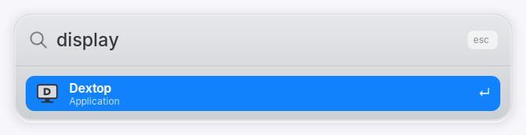
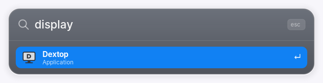

# Display — scaling and monitor changes

The panel is **2304x1440 in 259x162mm**, which is **~226 real DPI** — genuine Retina
density, comparable to a MacBook Pro. At stock settings every UI element is drawn at
native pixel size, so a fresh install is close to unreadable.

## Laptop sizing baseline

| Setting | Value | Effect |
|---|---|---|
| `xsettings /Gdk/WindowScalingFactor` | **1** | window/widget scale |
| `xsettings /Xft/DPI` | **168** | font scale (1.75x of the 96 baseline) |
| `xsettings /Gtk/CursorThemeSize` | **40** | pointer size |
| `xfce4-panel /panels/panel-1/size` | **52** | bar height |
| `xfce4-panel /panels/panel-1/icon-size` | **36** | bar icons |

```bash
xfconf-query -c xsettings    -p /Xft/DPI -s 168
xfconf-query -c xsettings    -p /Gdk/WindowScalingFactor -s 1
xfconf-query -c xsettings    -p /Gtk/CursorThemeSize -s 40
xfconf-query -c xfce4-panel  -p /panels/panel-1/size -s 52
xfconf-query -c xfce4-panel  -p /panels/panel-1/icon-size -s 36
```

All of these apply **immediately**. No logout, no restart.

> Creating `/Xft/DPI` for the first time needs an explicit type:
> `xfconf-query -c xsettings -p /Xft/DPI -n -t int -s 168`.

---

## Why it is split this way

**XFCE only does integer window scaling.** `Gdk/WindowScalingFactor` can be 1 or 2 —
there is no 1.5. On this panel:

- **2x was far too large.** Everything doubled in physical size; unusable.
- **1x with default 96 DPI is far too small.** The starting state.

So the working configuration is `WindowScalingFactor=1` with `Xft/DPI` raised to get a
fractional-feeling result. **Only fonts scale.** Every pixel-sized icon still renders
at raw size, which is why icons must be enlarged individually and why the bar and
cursor have their own explicit sizes above.

DPI was tuned by eye in stages: 96 (too small) → 144 (still too small) → **168**
(accepted). 192 is the true 2x-equivalent and was rejected as too large.

## If you change the scale

- **`Gtk/CursorThemeSize` and the panel sizes do not follow DPI.** Scale them by hand
  or the pointer and bar will look wrong against the new text size.
- **`xfwm4 /general/margin_top` must equal the panel height.** The panel sets no
  struts on this system, so that margin is the only thing keeping maximized windows
  from rendering under the bar. See [desktop.md](desktop.md).
- Some applications keep their own scaling and will not follow xsettings —
  **Electron apps** in particular.
  **Chrome does follow it**: a `chrome://gpu` export reports `scale=1.75` and a
  1317x823 work area, which is 168/96 and 2304x1440 divided by it. Verified 2026-09-04.
- **Firefox follows it too — corrected 2026-09-06.** This list used to name Firefox
  as needing `layout.css.devPixelsPerPx` by hand. Firefox 155 does not: a profile
  with **no prefs at all** reports `devicePixelRatio` **1.765** and a 1306-CSS-pixel
  screen, which is 2304 physical divided by it. That is 0.8% off the desktop's
  1.75 and not visible. **Do not set `layout.css.devPixelsPerPx`** — setting it
  would pin Firefox to a fixed ratio and break it the next time the panel or the
  DPI changes. The old advice predates this Firefox.

## Video decode

The GPU is Gen8 Broadwell and libva auto-selects the Gen9+ `iHD` driver, which on this
part has no encode entrypoint at all. `i965` is the right driver here and is forced via
`/etc/X11/Xsession.d/56mintbook-libva` — see [hardware.md](hardware.md) Graphics / VA-API.
It was previously forced only via `/etc/environment.d/`, which the desktop never
reads; that is why `doctor` reported `iHD` for so long.

Neither driver decodes **VP9 or AV1**; Broadwell has no such silicon. Sites that
default to those codecs still decode on the CPU, and this chip is fanless, so that is
felt as heat rather than as dropped frames.

Chrome's own `chrome://gpu` confirms this from the other side: its hardware decode list
is h264 baseline/main/high and vp8, and nothing else. **That list is a capability
claim, not behaviour** — measured 2026-09-06, Chrome decodes in software here
regardless. See [video.md](video.md). Decode was **already hardware
accelerated before** the driver change — see [hardware.md](hardware.md), What Chrome
actually does. Encode was not.

Re-checked 2026-09-06 with i965 confirmed live in Chrome's GPU process: the decode
list is **identical**, and encode is **still software-only** under every flag tried,
including `--ignore-gpu-blocklist`. That closes the question the earlier session left
open — it is Chrome's gate, not the driver. See [hardware.md](hardware.md),
Encode with i965 live. **The only remaining playback lever is still codec selection:
getting sites to serve H.264 instead of VP9/AV1. That has not been measured here.**

## Screenshots

`xfce4-screenshooter` is the only screenshot tool installed (no `scrot`, `maim`, or
`import`). This keyboard has **no Print key** — use the Super (Cmd) chords in
[desktop.md](desktop.md). Files land in `~/Pictures/Screenshots/`:

```
Cmd+Shift+3   fullscreen
Cmd+Shift+4   region
Cmd+Shift+5   window
```

A 160ms full-screen white flash follows a successful save (not in the PNG).
Do not bind `<Super><Shift>3` in xfconf; XFCE looks up `numbersign` /
`dollar` / `percent`. Do not pass `-s` a directory. See [desktop.md](desktop.md).

From a terminal, to check scaling:

```bash
xfce4-screenshooter --fullscreen --save /tmp/screen.png
```

## Brightness keys and Control Center (2026-10-08)

`bin/brightness-install` versions the curve that was previously installed only
in the home directory. It preserves `~/.config/mintbook/backlight-curve.env`
and the base Redshift configuration. Both XF86 brightness keys call
`backlight-curve step ±5`; the Control Center calls the same helper. XFCE's
independent power-manager brightness key handler is disabled to avoid two
writers. The existing brightness watcher now uses direct Python file reads
once per second, with no idle shell/subprocess churn.

The tray uses the saved perceived percentage only when its hardware value
matches sysfs; otherwise it shows actual hardware and the watcher reconciles
it. There is no time-based suppression window to swallow a key press. Settings
are serialized and failed hardware/gamma writes do not publish success.

One systemd-owned Redshift process combines Night Light and software dimming.
Command-line overrides apply the same brightness multiplier during day and night;
Night Light Off changes temperature to 6500 K while retaining dimming. The
persistent base config is not rewritten on each adjustment.

Undo: `bin/brightness-install --revert`. The first install saves previous scripts,
units, plugin, shortcuts and the power-manager key setting under
`~/.local/state/mintbook/brightness-before-*`; curve preferences are retained.
See [the top-bar review](top-bar-review.md) for tests and measured costs.

Redshift keeps the existing base config path allowed by AppArmor; no new policy
permission or generated runtime config is needed.

## Primary-display sizing (2026-10-20)

The customized desktop is XFCE, with a Plank dock and an XFCE system panel.
The panel must have `/panels/panel-1/output-name = Primary`: an automatic
output choice did not follow the primary-monitor selection on this machine.
This is a persistent XFCE preference, not a Cinnamon panel setting.

The first ultrawide connection exposed a second issue: `WindowScalingFactor=1`
was still accompanied by `Xft/DPI=168`. That is 175% font scaling, which Chrome
and the custom Cairo menus also use. The Samsung 3440×1440 display reports
797×333 mm (~110 DPI); the Retina font setting made its UI oversized.

`display-session` now starts with the managed panel through
`mintbook-display.service`. It listens to GDK monitor/size changes and XFCE's
display settings, debounces changes for 750 ms, and changes sizing only when the
primary monitor changes. No idle polling or repeated
xrandr commands. The one xrandr query per settled event reads EDID identity;
plugging the same monitor into a different port retains its preferences.

- The first run saves the existing laptop sizing in
  `~/.config/mintbook/display-sizing.json`, outside the versioned releases.
- Internal displays and external displays reporting 150–400 DPI use that
  Retina baseline (currently 168 DPI, 40px cursor, 52px bar and 36px icons).
- Other external displays default to 96 DPI, a 24px cursor, 40px bar and
  24px panel icons. The bar retains room for the existing 34px SVG indicators.
- The window-manager fallback top margin always changes with the bar height.
  The panel's enabled strut remains the real reserved area.
- WhiteSur window decorations switch between ordinary and installed `-hdpi`
  variants while retaining Light/Dark. Other window themes are left alone.
- Manual edits are remembered when leaving a primary monitor; changing
  secondary-monitor geometry does not overwrite or reapply sizing.
- XFCE retains control of primary selection, resolution, layout and refresh
  rate. This helper does not disable outputs, move windows, or select modes.

**X11 limitation:** font DPI is session-wide, so mixed-density screens share
the primary display's sizing. This does not provide macOS-style independent
per-monitor scaling. Some already-running applications cache DPI and need a
restart; Mintbook popups read it when they launch. Manual sizing edits are saved after a short debounce and survive service
restarts. Invalid/missing physical dimensions use the standard external default;
user preferences take precedence after a monitor has been used.

Read-only inspection: `~/.local/bin/display-session status`.
Install code using `bin/desktop-install`, which validates and activates a
self-contained release. Undo: run `~/.local/bin/desktop-install --rollback`
to remove the watcher, then run the new checkout's `bin/display-session restore`
to restore the saved laptop sizing. The sizing file is intentionally retained.

### Related edges observed in this setup

- The laptop is currently 1920×1200 rather than its native 2304×1440. That can
  reduce sharpness. It was left alone to preserve the selected layout.
- The ultrawide advertises 49.99 Hz as its only 3440×1440 mode on the current
  connection. This can limit smoothness; a higher refresh rate was not forced.
- `window-place` already restores windows within the current monitor workarea
  after an unplug. Overview and screenshot notifications already use primary
  workarea geometry; Control Center anchors to the pointer's monitor.
- Unplug/replug, lid-close, sleep/wake, and use of a different physical monitor
  require operator testing. They are not simulated by disconnecting hardware.

Installation exposed an existing release-integrity edge: genmon saved an extra
blank line through its rc symlink, modifying the active immutable release. Panel
rc files are now materialized as private writable user preferences at activation;
release copies remain hash-verifiable after a plugin save. The affected prior
release's rc was restored to its exact manifest hash before retrying activation;
its effective settings were unchanged.

### Validation

The full suite passed (423 tests); the additional writable-preference regression
and all 34 desktop-runtime tests also passed with private D-Bus access. Nine
sizing tests cover dock/undock transitions, new and unknown-density displays,
EDID identity across ports, remembered edits, restart, missing-primary events,
failed settings writes and failed preference saves.

Live on the Samsung: 96 DPI, 24px cursor, 40px panel, 24px panel icons, 40px top
margin, ordinary WhiteSur-Light decorations. X11 reports the panel at
`3440x40+1920+0`, matching the primary output. Both services are active and the
release manifest verifies. The watcher accumulated zero CPU ticks during a
five-second idle sample. Overview was visually inspected at actual scale in
both appearances and dismissed; previews did not change the saved appearance.




## Consistent status-bar scale and manual adjustment

The initial 96-DPI change exposed a rendering mismatch: genmon images retained
34px SVG canvases while clock/temperature text followed DPI. The collector now
uses one shared SVG viewport rule for custom indicators and CPU graphs:
20 logical pixels at 96 DPI, 25 at 120, and 35 at 168. SVG viewBoxes remain
unchanged, so outlines, padding and graphs scale proportionally without raster
resampling. Repeated identical renders do not rewrite the image cache.
The temperature uses Inter Medium 10, matching the clock's point-size rhythm;
the battery percentage has larger embedded digits to remain legible at the
smaller viewport. Third-party application icons retain their existing sizing.

Use Display Settings' Scale control for whole-screen scaling. For fine font/menu
size, open Appearance → Fonts → Custom DPI (96=100%, 108=112.5%, 120=125%).
The search launcher now offers **Display Settings** and **Adjust Text and
Interface Size**. The latter opens XFCE's existing Appearance preferences.
Window Scaling in Appearance is the separate coarse 1×/2× control.

The watcher now saves manual DPI/panel/cursor/icon edits after a short debounce,
including before a service restart. DPI changes update the custom icon viewport,
cursor, panel dimensions, decorations and window margin. Monitor identity no
longer changes with resolution/density class, so using Display Settings' Scale
control cannot accidentally select another DPI profile and double-scale it.
Existing preference keys remain compatible. Whole-screen fractional scaling
may resample the display on this X11 desktop; DPI changes retain vector/text
sharpness but apply session-wide, as described above.
