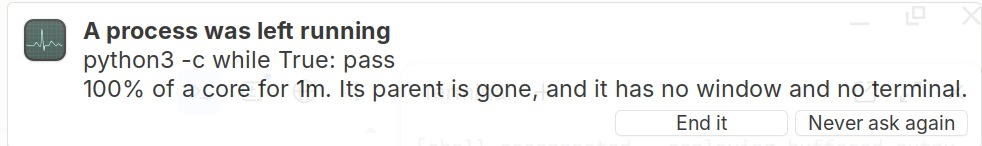

# Feel — ideas for perceived speed, and one measurement that reframes them

Every pass in this repository so far has asked *how much work is the machine
doing*. This one asks a different question: **how fast does it feel**, which is
a different quantity and has different levers.

Nothing here is applied. This is a candidate list, ranked, written on
**2026-09-06** after probing the live machine. One measurement was taken, and it
changes how the rest should be read.

---

## The measurement: there is no burst state to protect

Two busy-loop threads for 48 s. On AC, `balanced`, `max_perf_pct=100`, desktop
live with an Electron app open.

```
   t      MHz_avg   PkgTemp
  2.8s      1900     95.0
  5.6s      1800     94.0
 ...        1700-1940  94-95
 48.0s      1900     94.0
```

At rest under the same desktop, the package sits at **71–77 °C**. Under load it
reaches its **95 °C** limit inside the first sample — under three seconds — and
stays pinned there for as long as the load lasts, at **1700–1900 MHz** against a
2400 MHz maximum.

So: **the binding constraint is thermal, always, and it binds within about three
seconds.** There is no sustained fast state on AC that the battery profile is
taking away. What the machine actually has is roughly three seconds of turbo,
followed by ~75% of maximum clock indefinitely.

Limits of this measurement, which are not small:

- `MHz_avg` is `/proc/cpuinfo` averaged over four logical CPUs, two of them idle.
  Read it as indicative of the ceiling, not as a per-core clock.
- RAPL `energy_uj` is not readable without root, so there are **no watts** here.
- The "at rest" figure is a live desktop with an agent session running, not a
  clean idle. It is the operating reality, not a baseline.

### What follows from it

**The battery cap costs the burst and almost nothing else.** `max_perf_pct=70`
is ≈1680 MHz, which is at the bottom of the 1700–1900 MHz band the machine
sustains anyway. After the first few seconds the cap is very nearly free; before
them it removes the entire fast window — and the first few seconds is the only
part of a click a person perceives. *This is an inference from the numbers above,
not a measurement.* Testing it means timing a short interactive-length task
(cold app launch, page render) capped and uncapped, not a long benchmark.

**Idle temperature is a performance parameter.** Burst duration is proportional
to thermal headroom, and headroom here is ~15 °C. Every watt taken out of the
idle draw — panel brightness, compositor, background CPU — buys burst *length*,
not just battery. That reframes the whole power-tuning history in this repository
as latency work.

---

## Where each one ended up

| | idea | state |
|---|---|---|
| 1 | Keyboard repeat | **applied** — 500 ms / 20 Hz → 200 / 40 |
| 2 | Quiet the maintenance timers | built and measured; **needs one root command** |
| 3 | Cap the sustained, not the burst | measured, built, **running** |
| 4 | Priority for the desktop | measured by proxy, built; **needs one root command** |
| 5 | Focus-follows-priority | built, **running** — reach is limited, see below |
| 6 | Writeback in bytes | written, **unproven**; needs root |
| 7 | Warm the page cache | built, **running** |
| 8 | Remove a frame | **not measured** — not measurable from inside the machine |
| 9 | Acknowledge input under 150 ms | **measured; already inside it.** Nothing changed |
| 10 | Render fewer pixels | built, **deliberately not applied** |

Three of the ten turned out differently from how they were written down. Item 2
was worth having for a different reason than it claimed, item 6 lost its
supporting evidence, and item 9 was already fine. Those are in the entries.

## Tools this pass added

All read-only or self-restoring, and none need root.

| | |
|---|---|
| [`bin/burst-probe`](../bin/burst-probe) | Times interactive-length work under each CPU cap, interleaved |
| [`bin/desktop-latency`](../bin/desktop-latency) | X round-trip latency under load, against a niced competitor |
| [`bin/io-stall`](../bin/io-stall) | What a bulk write or a metadata storm does to the desktop |
| [`bin/cold-read`](../bin/cold-read) | Cold application read time, with and without disk contention |
| [`bin/pixel-budget`](../bin/pixel-budget) | Compositor cost of the Retina panel. Rearranges windows |
| [`bin/quiet-timers`](../bin/quiet-timers) | `--check` lists every maintenance unit and what it is set to |
| [`bin/desktop-nice`](../bin/desktop-nice) | `--check` lists the desktop's nice values |
| [`bin/focus-priority`](../bin/focus-priority) | `--check` lists real app trees and thread priorities |
| [`bin/warm-cache`](../bin/warm-cache) | `--check` lists what would be read, and free memory |
| [`bin/turbo-budget`](../bin/turbo-budget) | `--check` reports the cap and whether the budget is armed |
| [`bin/runaway-watch`](../bin/runaway-watch) | `--check` lists orphaned processes and what they are burning |

## What is left for root

Three commands, in one block, none of which this session could run:

```bash
sudo bin/quiet-timers
sudo install -m755 bin/desktop-nice /usr/local/sbin/mintbook-desktop-nice
sudo install -m644 config/systemd/mintbook-desktop-nice.{service,timer} /etc/systemd/system/
sudo systemctl daemon-reload && sudo systemctl enable --now mintbook-desktop-nice.timer
# and, only after the launch-during-write test in item 6:
sudo install -m644 config/sysctl.d/99-mintbook-feel.conf /etc/sysctl.d/ && sudo sysctl -p /etc/sysctl.d/99-mintbook-feel.conf
```

---

## Ranked candidates

### 1. Keyboard repeat — **applied**, 500 ms / 20 Hz → 200 ms / 40 Hz

```
before   auto repeat delay:  500    repeat rate:  20
after    auto repeat delay:  200    repeat rate:  40
```

Nothing set it — the `keyboards` channel held only `/Default/Numlock`, so
`xfsettingsd` left X11's own defaults in place. Every held arrow key, every
backspace run, waited half a second and then crawled at 20 Hz.

Set through xfconf, which both applies immediately and persists across logins:

```bash
xfconf-query -c keyboards -p /Default/KeyRepeat       -n -t bool -s true
xfconf-query -c keyboards -p /Default/KeyRepeat/Delay -n -t int  -s 200
xfconf-query -c keyboards -p /Default/KeyRepeat/Rate  -n -t int  -s 40
```

Undo: set `Delay` back to 500 and `Rate` to 20, or `xfconf-query -c keyboards -p
/Default/KeyRepeat/Delay -r` to drop the properties entirely and return to the X
default. If held keys overshoot, `Rate` 30 is calmer; the delay is the half that
matters most.

**A claim in the first draft of this file was wrong and is corrected here.** It
said macOS "ships far faster" on this hardware. It does not: macOS defaults to
`InitialKeyRepeat` 25 (≈375 ms) and `KeyRepeat` 6 (≈90 ms, ≈11 Hz) — a *slower*
repeat rate than X11's 20 Hz, with a shorter delay. The case for this change is
not that macOS is quicker. It is that both defaults are conservative, the delay
is the part a person feels, and 200 ms is where a held key stops feeling like a
request and starts feeling like a control. The macOS-power-user equivalent is
roughly 225 ms / 33 Hz, which is close to what is set here.

This changes no work the machine does. It was the highest felt value per minute
of effort on the list, and it is done.

### 2. Fix the worst moments, not the average — **built, measured, needs one root command**

The SSD controller takes **one command at a time** (`qdepth_one`), and
`nr_requests` is **2**. A background job therefore does not *share* this disk
with the desktop. It takes it. Twelve maintenance units fire on their own timers
and do exactly that: `apt-daily`, `apt-daily-upgrade`, `plocate-updatedb`,
`man-db`, `e2scrub_all`, `fstrim`, `motd-news`, `fwupd-refresh`, `anacron`,
`logrotate`, `dpkg-db-backup`, `systemd-tmpfiles-clean`.

[`bin/quiet-timers`](../bin/quiet-timers) installs a drop-in on each one.
`--check` is read-only and needs no root; `--undo` removes them.

**What that is worth was measured, and it is not what this entry first claimed.**
The original claim — that a busy disk makes the desktop go to glue — did not
reproduce. A 512 MB write and a full metadata walk of `/` each left X round trips
essentially untouched, while I/O pressure tripled. The X server does no disk
I/O; it was the wrong probe for the question.

What a busy disk *does* cost is **application launches**.
[`bin/cold-read`](../bin/cold-read) evicts a 177 MB library and times reading it
back:

```
quiet      median   905 ms
contended  median  1668 ms      +763 ms, 1.8x, arms not overlapping
```

And cold versus cached on the same file is **881 ms against 85 ms** — a factor
of ten. All three runs, including the two that found nothing:
[2026-09-06-io-contention.md](measurements/2026-09-06-io-contention.md).

So this change is worth having, for a narrower and better-understood reason than
the one it started with: it keeps a timer from doubling the launch time of the
next thing you open.

**The obvious way to do it does not work here, and that is worth recording.**
`IOSchedulingClass=idle` is *already* set on `plocate-updatedb`, `man-db` and
`systemd-tmpfiles-clean` by their own packages — and does nothing, because
**mq-deadline implements no I/O priorities**. Only BFQ does, and BFQ is not
loaded (switching to it would reopen a scheduler question this repository
already settled by measurement). ionice is inert on this machine no matter who
sets it.

What is enforced whatever the elevator is, is blk-throttle:

```
Nice=19
CPUWeight=10
IOReadBandwidthMax=/dev/nvme0n1  32M
IOWriteBandwidthMax=/dev/nvme0n1 16M
IOSchedulingClass=idle            # inert here; kept for a scheduler that honours it
```

Setting any `IO*` property is also what makes systemd enable the `io` controller
down `cgroup.subtree_control`, which is otherwise `cpu memory pids` — the
throttle knobs do not exist until a unit asks for them.

Not yet applied: needs root, and no password is available to this session.

```bash
sudo bin/quiet-timers        # then: bin/quiet-timers --check
```

### 3. Cap the sustained, not the burst — **measured, built, running**

The inference above is now a measurement. [`bin/burst-probe`](../bin/burst-probe)
times a fixed ~1 s single-core task under each cap, interleaved, and prints the
spread inside each arm:

```
uncapped (100)  n=5  mean 661 ms   min 589  max 744   spread 155 ms
capped   (70)   n=5  mean 903 ms   min 839  max 967   spread 128 ms

cap costs +241 ms on ~1 s of work (+36.5%)
```

**The arms do not overlap.** The slowest uncapped run is faster than the fastest
capped one, and package temperature (72–80 C) did not sort with the arms. Raw
numbers: [2026-09-06-burst-cap.md](measurements/2026-09-06-burst-cap.md).

So both of these are true, and they are not in conflict:

| length of work | faster | source |
|---|---|---|
| ~1 second | **uncapped**, by 36.5% | this measurement |
| sustained | **capped** — 75 does 20–25% more work than 100 | [hardware.md](hardware.md) |

An uncapped chassis sprints into the 95 C wall and then eats throttle stalls.
A capped one never gets the sprint. [`bin/turbo-budget`](../bin/turbo-budget)
takes both: while a cap is in force it grants **8 uncapped seconds** at the
start of any burst, then hands the cap back and keeps it until the machine goes
quiet. A click gets the whole chip; a compile gets the cap it was always going
to get.

Verified live, on a forced `power-saver` baseline:

```
t= 1.0s  cap=70          quiet
t= 1.5s  cap=100         burst detected
t= 8.5s  cap=100         still inside the budget
t= 9.0s  cap=70          budget spent — cap back, under continuing load
```

It needs no root: it writes a profile name to `/run/mintbook-power/want`, the
password-free channel the panel already uses, and it stands down entirely
whenever nothing is capped — so picking Balanced by hand switches it off.

**Its own cost, because this repository has been bitten there before:** under
10 ms of CPU in 29 s of running. The loop forks nothing — `/proc` through the
`read` builtin, time from `EPOCHREALTIME`, arithmetic in bash, and the sleep is
a `read` timeout on a fifo nobody writes to. The most expensive software ever
found on this machine was a panel plugin that forked a Python interpreter twice
a tick.

```bash
systemctl --user enable --now mintbook-turbo-budget.service   # installed and running
systemctl --user disable --now mintbook-turbo-budget.service  # undo
```

Tunable through the environment: `BUDGET` (8 s), `TRIGGER` (25% of total CPU),
`QUIET` (15%), `QUIET_FOR` (8 samples), `COOLDOWN` (45 s), `MINGAP` (3 s).

**A bug found by testing it on battery, which is the only state where it does
anything.** The first version re-armed when a single sample fell below 10% of
total CPU. On a desktop with a live Electron application in it, that essentially
never happens — so after one sustained burst the budget parked in `spent` and
never gave another. It was verified on AC, where the daemon stands down and the
fault is invisible. Re-arming now needs the machine quiet for a stretch, *or*
`COOLDOWN` seconds regardless, and a four-cycle trace confirms it:

```
state=normal → request balanced → state=boosted → request power-saver → state=spent
state=normal → request balanced → state=boosted → request power-saver → state=spent
                                                                    ... ×4
```

**And a limitation that trace also shows.** Under *continuous* background load —
an agent, a sync, a busy Electron app — the budget is spent on that load, on a
cycle of eight uncapped seconds per cooldown, and may simply not be available at
the moment you click. The trigger is CPU, and CPU cannot tell your click apart
from a background thread. Tying it to input instead of load is the obvious next
version and has not been written.

**A second bug, found from the journal: it flip-flopped.** On battery on
2026-09-10 and 2026-09-11, `journalctl -t mintbook-power` showed the profile
going `balanced`, `power-saver`, `balanced` every 3 s for minutes at a time, with
nobody touching the panel. It was this script. A boost ended on a *single*
sample under `QUIET` and went straight back to `normal`, skipping the
quiet-for-a-stretch rule that re-arms `spent`, so the next sample over `TRIGGER`
bought a fresh 8 s. On a desktop hovering around 15–25%, that alternates as fast
as `MINGAP` allows. The journal carries the fingerprint: of 109
`balanced`→`power-saver` changes on 2026-09-11, 68 came 2–3 s into the boost —
the `MINGAP` floor, not a burst ending — and after 72 such early ends, 28 boosts
were granted again within 6 s. Each change is not free either: it runs
`powerprofilesctl`, a Python program, as root (110 ms of CPU in the one sample
that caught it).

Now a boost ends early only after `QUIET_FOR` quiet samples in a row, the same
rule that re-arms `spent`. Old and new, run side by side against the same
synthetic `/proc/stat`, with the cap pinned at 70 and requests counted rather
than applied:

| load | old: changes/min, uncapped | new |
|---|---|---|
| intermittent: 0.5–2 s of work, 0.5–1.5 s pauses (120 s) | 17.5, 61 s | 3.0, 23 s |
| hovering, 5–40% per sample (120 s) | 5.0, 26 s | 3.0, 23 s |
| a 1 s burst every 20 s (60 s) | 4.0, 5 s | 4.0, 6 s |
| sustained 45% (60 s) | 3.0, 8 s | 3.0, 8 s |
| a 0.75 s spike every 4 s, quiet between (60 s) | 16.0, 20 s | 16.0, 21 s |

The old version's intermittent run changed profile every 2.5–4.3 s, the
journal's cadence. The new one boosted for 8 s, spent, and waited out
`COOLDOWN`. What it costs: a boost now outlives its burst by the 2 s it takes to
call the machine quiet, about 1 s more uncapped time per minute in the click
row.

Not fixed: the last row. Spikes more than 2 s apart are each a new burst by this
definition, so each still gets its boost — 16 changes a minute. That is the
CPU-not-input limitation above, again. The simulation was all there was at first — the
machine was on AC — and the live check below says it was not enough. Not examined: the 2026-09-10 bursts (18:03, 21:27) had rotated out
of the journal, so the diagnosis rests on 2026-09-11's. And the journal could
not say who asked, because every writer of `/run/mintbook-power/want` produces
the same `mintbook-power` line. turbo-budget now logs each request with its
reason: `journalctl --user -u mintbook-turbo-budget`.

**Checked live on battery the same morning, and it is not enough.** In the first
2 min 18 s unplugged (2026-09-11 10:00:50) it made 16 requests, about 7 a
minute, mostly `burst over`: real bursts with 2 s of quiet between them. That is
the last row of the table, and on this desktop it is the ordinary case, not an
edge. After that, with an agent session running, it settled into one boost every
~53 s (10:03:00, 10:03:53, 10:04:46, 10:05:39, 10:06:32): a burst, 8 s,
`budget spent` at 21–62% CPU, 45 s of `COOLDOWN`, and then the next sample over
25% — background load, not a click — took the budget again the moment it
re-armed. Under that load it spends ~15% of the time uncapped on background work,
and the budget is almost never there when you click.

An end-to-end timing tried to measure what it gives a click: a ~1 s single-core
task, interleaved over six rounds, on battery:

| arm | median | range |
|---|---|---|
| turbo-budget running, cap 70 | 943 ms | 883–1000 |
| static cap 70 | 980 ms | 865–1147 |
| uncapped | 628 ms | 592–670 |

In none of the turbo-budget runs did the cap lift before the task ended. That is
**not** a clean measurement of its best case. Each round restarted the service
and set the profile, the switch itself is a burst (`powerprofilesctl` is
Python), and that burst spent the budget, so every one of those runs started in
`spent`. What it does show is the operating reality above: the budget was gone
before the work arrived. Whether a lone thread can trigger it from a cold start
was not tested. One thread is at most 25% of four logical CPUs, against a 25%
trigger.

**What would work, measured before building it.** Two changes were proposed:
trigger on input instead of CPU load, and write the cap directly instead of
through the root channel. [`bin/boost-probe`](../bin/boost-probe) times
single-core work in four interleaved arms, each starting capped
([raw numbers](measurements/2026-09-11-boost-at-input.md)):

| work | cap 70 | cap lifted at input, direct write | same, through `want` | already uncapped |
|---|---|---|---|---|
| ~1 s | 1000 ms | **718 ms** | 837 ms | 741 ms |
| ~0.15 s | 206 ms | **152 ms** | 189 ms | 154 ms |

A direct write at the moment of input gets back everything the cap costs: it
matches the already-uncapped arm. The same boost through the path unit, root
script and `powerprofilesctl` gets back ~60% on the long task and ~30% on the
short one, because it lands after the work has started. So the channel was half
the problem, not a detail. Even a perfect trigger could not have fixed
turbo-budget.

If the daemon is killed with `SIGKILL` while boosted, the cap stays at 100 until
something else asserts it — the next AC transition, or `power-apply --reassert`.
`SIGTERM`, which is what `systemctl --user stop` sends, restores it.

Not measured: what the extra 8-second sprints cost in battery life or in
temperature over a real session. The sprints are short and the chassis was
already reaching 95 C under any sustained load, but that is an argument, not a
number.

### 4. Nice the things you look at — **corrected 2026-09-10**

> The timer was subsequently installed. Its original list boosted launchers,
> which passed -5 to apps and weakened the intended separation. The installed
> correction retains -5 only for Xorg/xfwm4 and restores launchers to 0.
> [priority.md](priority.md) describes the current implementation and undo.
> The experiment and installation notes below describe the original proposal.

`Xorg`, `xfwm4`, `xfsettingsd`, `xfdesktop`, `xfce4-panel` and `plank` all run
at nice **0**, competing on two cores with whatever else is running. Everything
visible goes through them, so on a saturated machine the desktop is what gets
preempted: the machine is not slower, it only looks it.

[`bin/desktop-latency`](../bin/desktop-latency) measures that, by loading the
machine twice and timing X round trips under each arm:

```
idle       median  16 ms   p95  34 ms
competing  median  40 ms   p95  64 ms      load at nice 0
niced      median  27 ms   p95  41 ms      load at nice 19
```

Load costs the X server **+24 ms** of median round trip; separating priorities
returns **13 ms**, and p95 falls from 64 ms to 41 ms. Raw:
[2026-09-06-desktop-latency.md](measurements/2026-09-06-desktop-latency.md).

That measurement is a **proxy**: it nices the competitor *down*, because raising
Xorg up needs `CAP_SYS_NICE`. [`bin/desktop-nice`](../bin/desktop-nice) does it
from the other end, at nice −5, installed as a timer so it survives the logout
that restarts Xorg and the panel. `--check` is read-only; `--undo` puts
everything back to 0.

Not yet applied: needs root.

```bash
sudo install -m755 bin/desktop-nice /usr/local/sbin/mintbook-desktop-nice
sudo install -m644 config/systemd/mintbook-desktop-nice.{service,timer} /etc/systemd/system/
sudo systemctl daemon-reload && sudo systemctl enable --now mintbook-desktop-nice.timer
```

This makes the machine slower at work in order to keep it responsive while
working. That is the right trade for a laptop, and it is a trade, not a win.

### 5. Focus-follows-priority — **superseded 2026-09-09**

> The live CPU controller was absent, and Electron renderer/GPU children were
> outside the main-process scopes. The following is the historical design,
> not a description of effective scheduling. [priority.md](priority.md) records
> the replacement, its measured contention benefit, costs and installation.
> The former memory protection was not established either: ancestor protection
> was zero. Do not reinstall the old user unit.

systemd puts each application in its own cgroup scope.
[`bin/focus-priority`](../bin/focus-priority) follows `_NET_ACTIVE_WINDOW`,
resolves the focused window to its scope, and gives that scope `cpu.weight`
**400** against **50** for everything else, plus `memory.low` of 512 MB so the
app you are looking at is the last thing reclaimed to zram — which matters at
`swappiness=180`.

A cgroup is the right unit here. The focused window belongs to one process, but
its renderers, GPU process and helpers are all in the same scope, so weighting
the scope weights the whole application without enumerating it.

It costs nothing between windows: `xprop -spy` blocks until the focus actually
changes. There is no polling loop.

Two things had to be solved, and both are worth recording:

- **`cpu.weight` did not exist on application scopes.** The `cpu` controller is
  available to `app.slice` but was not in its `cgroup.subtree_control`, and
  systemd only enables it there when a unit *inside* `app.slice` asks for it —
  which no desktop-launched scope does. The subtree is delegated to this user,
  so the script enables it itself, idempotently. Every scope simply gains the
  default weight of 100.
- **`_NET_ACTIVE_WINDOW` returns two window ids** (`0x5400004, 0x0`). Taking the
  last field, which is the obvious thing to write, yields `0x0` and resolves
  nothing — silently, because every lookup after it just fails. The first
  version of this script did exactly that and weighted the focused app *down*.

**Its reach is smaller than it looks, and that is the honest caveat.** Only
applications launched into their own systemd scope can be weighted. On this
desktop right now there is exactly **one** such scope. Anything launched by a
route that does not create a scope lands in the session's own cgroup, where
there is nothing to separate. `bin/focus-priority --check` lists what exists.

`io.weight` is not available at all: the `io` controller is not enabled at the
system level, and `io.weight` is a BFQ feature — see the note under item 2 about
why BFQ is not on this machine.

```bash
systemctl --user enable --now mintbook-focus-priority.service   # installed and running
systemctl --user disable --now mintbook-focus-priority.service  # undo, and it clears what it set
```

One sharp edge: because the script clears every weight it set when it exits,
running a second copy by hand and stopping it wipes the weights the *service*
had set, and the service will not notice until the focus next changes. Use
`--check`, not a second instance.

Not measured: whether this changes anything a person can feel, as opposed to
changing numbers in `cpu.weight`. With one scope in play it very likely does not
yet. The measurement to make is `bin/desktop-latency`-shaped, with a real second
application competing.

### 6. Writeback in bytes, not percent — **written, unproven, needs root**

`vm.dirty_ratio` is 20% of 7.8 GB: roughly **1.5 GB** of dirty pages that can be
handed at once to a device that accepts one command at a time. `vm.dirty_bytes`
of 64 MB (background 32 MB) makes a large save trickle instead of arriving as a
wall. `watermark_scale_factor` is the default **10**, so `kswapd` starts late
and the machine can reach *direct* reclaim — which is what a freeze is; 100
trades a little held-back memory for not getting there.

Both are in [`config/sysctl.d/99-mintbook-feel.conf`](../config/sysctl.d/99-mintbook-feel.conf).

**Unproven, and the one test run argues against it.** The 512 MB write in
measurement 1 above never came close to the 1.5 GB limit and disturbed nothing,
so the stall this is meant to prevent was not reproduced. What was *not* tested
is an application launch during a large write — which, given what item 2 found,
is where the cost would actually show. That test is the one to run before
applying this.

```bash
sudo install -m644 config/sysctl.d/99-mintbook-feel.conf /etc/sysctl.d/
sudo sysctl -p /etc/sysctl.d/99-mintbook-feel.conf
# undo: rm the file, then
# sudo sysctl -w vm.dirty_ratio=20 vm.dirty_background_ratio=10 vm.watermark_scale_factor=10
```

It is a trade in the direction of smoothness over bulk write throughput, and on
a `qdepth_one` device that is probably the right direction — but "probably" is
not a measurement, and this file does not pretend otherwise.

### 7. Warm the page cache for the apps you actually launch — **built, running**

Cold and cached, for the same 177 MB library, on this disk:

```
evicted   881 ms
cached     85 ms      10x
```

There is 5.0 GB of memory available and the apps worth warming come to
**624 MB**. [`bin/warm-cache`](../bin/warm-cache) reads each app's binary, its
libraries and its install directory into the page cache, using memory that is
otherwise idle to spend nothing and remove that wait. The kernel remains free to
drop any of it under pressure, which is the correct behaviour.

Resolving an app to its files is the part that needed care: `firefox` and
`google-chrome` are wrapper scripts, and their real weight — `libxul.so` is
177 MB — is `dlopen`ed, so it appears in no `ldd` output. The script takes the
install directory's own shared objects as well.

```bash
systemctl --user enable --now mintbook-warm-cache.timer   # installed; runs 3 min after login
bin/warm-cache --check                                    # what it would read, and free memory
```

Not measured: whether a warmed Firefox actually *starts* faster, as opposed to
reading faster. Proving that needs `drop_caches`, which needs root, and a real
launch after a real boot.

### 8. Remove a frame — **not measured, and here is why**

Compositing adds a frame at 59.94 Hz: about **17 ms** between input and photon.
`xfwm4`'s `/general/vblank_mode` is `auto`; the alternatives are `xpresent`,
`glx` and `off`, and on Intel they are measurably different.

Measurably — but not *here*. Input-to-photon latency is the time from a key
being pressed to light leaving the panel, and nothing inside the machine can see
the second half of that. A camera or a photodiode can; software cannot. The
quantity that software *can* measure — compositor CPU — is not the quantity in
question, and reporting it would be answering an easier question and hoping
nobody notices.

So this is left set to `auto`, and the toggle is written down rather than
guessed at:

```bash
xfconf-query -c xfwm4 -p /general/vblank_mode -s xpresent   # or glx, or off
xfwm4 --replace &                                           # the compositor must restart
xfconf-query -c xfwm4 -p /general/vblank_mode -s auto       # undo
```

`off` will tear. The macOS look this machine is built around needs compositing,
so `off` is not really on the table; the honest choice is between `auto`,
`xpresent` and `glx`, decided by someone watching the screen.

### 9. Acknowledge input in under 150 ms — **measured, and already inside it**

The idea: what makes a machine feel fast is that *something* happens promptly,
not that the work is finished. So the Overview launcher, which is the most-used
interaction on this desktop, should paint within about 150 ms of Cmd+Space.

Measured, it already does:

```
rofi process startup            47–50 ms
all 153 .desktop files, warm      65 ms
```

`StartupNotify=true` is already set on every launcher entry in the dock, so
application launches do raise a startup-notification sequence.

The one change available — rofi's `drun-use-desktop-cache`, currently `false`,
which would skip re-parsing those 153 files each time — is **not worth taking**.
It saves a few tens of milliseconds inside a budget that is already met, and it
buys a stale menu: newly installed applications do not appear until the cache is
regenerated. Recorded here so nobody re-derives it.

Nothing was changed for this item. That is the result, not an omission.

### 10. Render fewer pixels — **built, deliberately not applied**

2304×1440 at 168 DPI on an HD 5300: every frame the compositor draws is
**3.3 megapixels**. Rendering fewer of them is the largest single lever left for
UI smoothness on this GPU.

[`bin/pixel-budget`](../bin/pixel-budget) will measure it — `--measure` samples
Xorg and xfwm4 CPU at native, then at a reduced scale, then at native again, so
the two native arms bracket the middle one and disagreement between them is
visible as noise.

**It was not run, and the change is not applied.** Two reasons, and the first is
the honest one:

1. What it spends is sharpness, on the Retina panel that is the entire point of
   this machine. "Looks like macOS" is the project. A permanent trade of that for
   frame rate is the owner's call, not a tuning script's.
2. Changing the screen size makes the window manager move and resize every
   window, and it does not put them back. That is a rude thing to do to a live
   desktop without being asked.

```bash
bin/pixel-budget --measure 0.75    # ~45 s, and it will rearrange your windows
bin/pixel-budget --set 0.75        # apply
bin/pixel-budget --undo            # back to native
```

### 9. Acknowledge input in under 150 ms

What makes a machine feel fast is that *something* happens promptly, not that
the work is finished. A launch indicator in plank or Overview the moment a key
is pressed covers a cold-launch wait perceptually. It is the trick macOS used on
this exact hardware. Overview here is ours to change.

### 10. Render fewer pixels

2304×1440 at 168 DPI on a GT2 IGP: everything is rasterized and composited at
3.3 Mpx. Dropping the Electron/browser device scale factor a notch — or driving
the panel at 1920×1440 with scaled fonts — cuts that by roughly a third, which
is the largest single lever available for UI smoothness on this GPU. It costs
sharpness. On a Retina panel there is some to spend. `bin/app-probe` can measure
it the same way Reduce motion was measured.

---

## What this pass was actually about

Measure interactive-length tasks, not benchmarks. A throughput number cannot see
any of this — and, run the other way, an interactive measurement cannot see
throughput either, which is why item 3 had to be told that both of its
contradictory sources were right.

The two results worth carrying forward:

- **The machine has about three seconds of turbo and no sustained fast state.**
  Idle temperature is therefore a performance parameter, not a comfort one.
- **Background I/O costs launches, not drawing.** Two probes aimed at the
  compositor found nothing before one aimed at a cold read found 1.8x.

---

## 11. Notice what was left running — **built, running**

On 2026-09-07 a `python3 -` from a background task whose shell had exited sat
at 99% of a core for three and a half hours. Nothing said so. The chassis is
fanless, so the symptoms were the temperature reading, a desktop that felt
slow, and — found afterwards — a set of panel-open timings taken that
afternoon that read 570–670 ms against a documented 304. The measurement was
wrong because the machine was busy, and the machine was busy because of a
process nobody knew about.

[`bin/runaway-watch`](../bin/runaway-watch), on a five-minute user timer,
asks about it:

<p align="center">
  
</p>

### It is not a "high CPU" watcher, on purpose

High CPU is usually *correct*. A compile, an encode, a browser decoding video,
`turbo-budget` deliberately spending a burst — a notifier that interrupts
those is a notifier you turn off within a day, and then it is not there for
the one time it mattered. The value of this thing is entirely in how rarely it
speaks.

So it does not look for load. It looks for one shape, and every part of it has
to hold:

| test | what it rules out |
|---|---|
| `ppid == 1` | anything with a live parent — a shell, a supervisor, an IDE. Somebody owns it |
| no controlling terminal | anything printing to a window you have open |
| cgroup leaf is not a `*.service` | every systemd unit. A managed service is somebody's job by definition |
| no window on screen (`wmctrl -lp`) | every application. You have not forgotten something you can see |
| alive ≥ 10 minutes | every short task, and every launch that is briefly parentless |
| ≥ 80% of a core **since the last pass** | everything idle, and anything that was hot an hour ago and has since stopped |
| `comm` not on a short never-list | session plumbing that is legitimately parentless on some setups |

The CPU test is a rate over the five-minute gap, not an average over the
process's life, and it is load-bearing rather than decorative. Measured on
this machine, `--check` at the default bar lists **34** processes that pass
the parent/terminal/age tests:

| | |
|---|---|
| 19 | systemd units — journald, NetworkManager, bluetoothd, polkitd, upowerd… |
| 3 | have a window — Firefox, the Claude desktop app, ChatGPT |
| 12 | genuinely orphaned session leftovers — `mintreport-tray`, `mintUpdate`, `blueman-applet`, two crashpad handlers, and four `redshift` daemons |

Every one of them is between 0% and 7%. Four of the twelve are `redshift`,
which is orphaned, terminal-less and windowless and is the thing that turns
the screen warm at night: **without the rate test this would have offered to
kill the night light.** The unit and window tests carry the other 22.

### What it will not catch, and will not try to

- **A runaway with a living parent.** A stuck child of a supervisor that is
  still up fails the first test. That is the right miss: something is still
  responsible for it, and guessing otherwise is how a notifier starts
  suggesting you kill a build.
- **A memory leak, or a disk thrasher.** Only CPU is measured.
- **Anything with a window.** A hung GUI app pegging a core is visible, and
  the window manager already offers to kill it.
- **A deliberately detached job.** `nohup make -j4 &` in a terminal you then
  closed matches every test here, and it *will* be nominated. This is the one
  real false positive and there is no signal that separates it from a leak —
  the difference is entirely in whether you meant it. Which is why the
  notification asks instead of acting, names the command line so you recognise
  your own work in one glance, and carries a **Never ask again** button that
  writes the command to `~/.config/mintbook/runaway.ignore`.

It never ends anything on its own. The only thing that sends a signal is the
button, and it sends `SIGTERM`, then says so if that was ignored.

### One thing this found on the way

Four concurrent `redshift` daemons, ages 10h and 3×3.4h, where there should be
one. `bin/night-apply` has a `stop_redshift()` that SIGTERMs then SIGKILLs
every one it finds, behind an flock, with a comment saying multiple daemons
fighting over the RandR LUT is a failure mode it already knows about — and its
pid finder does match all four when run by hand. So the duplicates are real
and the cause is **not established**: the session that produced them is not
this one, and the obvious test (run `night-apply auto` and count) cannot be
run from the agent shell this was written in, which can signal its own
descendants and nothing else. `kill -0` succeeds on those pids and `kill
-TERM` returns `Permission denied`, so every `os.kill` in `stop_redshift`
would have been swallowed by its own `except OSError: pass` regardless of
whether the logic is right. Left open.

### Two things that had to be got right

**Pid reuse.** The question can sit on screen for hours — it is
`urgency=critical` so it does not expire unread — and in that time the process
can exit and the kernel can hand its pid to something innocent. Both the
nomination and the kill are keyed on `starttime` from `/proc/PID/stat`, which
is what makes a pid unambiguous; and between passes, a state row is discarded
unless the process aged by about the length of the gap.

**Cost.** The first version read `/proc/PID/stat` for all 286 processes with
the `read` builtin, forking nothing — and still cost **0.9 s of CPU a pass**,
most of it the temp file bash creates for the herestring that splits a line
into fields. That is 0.75% of a core continuously, on a machine whose panel
jobs were removed for costing 0.10%. One `ps -eo pid=,ppid=,tty=,times=,etimes=,comm=`
does the same walk in C:

```
systemd's own accounting, per pass:   223 ms
every five minutes:                   0.07% of a core
```

`cgroup` and `/proc/PID/cmdline` are read per *candidate*, not per process, so
a quiet machine never pays for them.

```bash
bin/runaway-install            # the five-minute user timer, no root
bin/runaway-install --revert   # take it off
bin/runaway-watch --check      # what it sees right now
bin/runaway-watch --ignore PID # never ask about that command again
```
