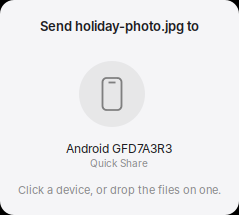
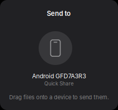

# Mintdrop — send a file to a machine that is nearby

> 2026-09-11. Working between Linux machines. The phone half is not built
> yet; the last section says exactly what it needs.

Pick a name, send a file, no cloud and no cable. On this machine it costs
nothing until it is used: there is no daemon, no timer and no polling — the
kernel holds a listening socket, and a process exists only while a file is
actually moving.

```
mintdrop peers                       what is nearby
mintdrop send "Studio iMac" a.pdf    send it
mintdrop status                      what is armed here
bin/mintdrop-install                 install; --revert puts it all back
```

## Four ways in

| | |
|---|---|
| **the dock** | drag files onto the Mintdrop icon in Plank |
| **Files** | right-click a selection → *Send with Mintdrop* |
| **the sheet** | `mintdrop-menu`, then drop files onto a device |
| **a terminal** | `mintdrop send` |

<p align="center">
  
  &nbsp;
  
</p>

The sheet is one window: round tiles for the devices that are nearby, a
glyph saying what kind of thing each one is, and the transfer drawn on the
tile itself as a ring closing clockwise from twelve. Dropping files on a tile
sends them; so does clicking one, when the sheet was opened with files
already. Escape closes it. Nothing is resident — discovery runs while the
window is open and stops when it closes.

The glyphs are drawn rather than taken from an icon theme, for the reason
`bin/bt-menu` draws its own: three shapes at one size, which then match the
appearance exactly and cannot go missing when a theme changes.

**Phones appear here already, marked *Quick Share*, and cannot be sent to
yet.** They are shown rather than hidden because a device that is genuinely
there and genuinely not ready is more useful to see than to omit — clicking
one says so.

### The right-click entry, and where it was wrong

Thunar keeps custom actions in `~/.config/Thunar/uca.xml`. The first version
of this installed a `.desktop` file into
`~/.local/share/file-manager/actions/`, which is where Nemo and Caja look and
where Thunar never does — so the entry the README promised did not exist.
`bin/mintdrop-install` now edits `uca.xml`, and:

- it **edits rather than replaces**: that file holds the user's own actions
- it is **idempotent**, keyed on the unique-id `mintbook-mintdrop`
- `--revert` **removes by that id** rather than restoring a backup, so an
  action added after the install is not silently deleted

Thunar may need `thunar -q` before the entry appears; Plank picks up its new
launcher on its own.

---

## Why this is not AirDrop, and why it is still native

This was asked for as "an airdrop". Apple's AirDrop cannot be built on this
machine, and the reason is worth writing down so nobody spends a weekend on it:

**AirDrop puts the data on AWDL**, Apple's peer-to-peer Wi-Fi link. Speaking
it on Linux means `owl`, which needs the wireless card in monitor mode *with
frame injection*. This machine's card is a **BCM4350 on `brcmfmac`** — no
injection, no monitor mode worth the name, and no nexmon firmware patch for
this chip. It is a hardware limit, not a missing library. An iPhone will not
see this machine in its AirDrop sheet, and no amount of code changes that.

**Quick Share — Samsung's and Google's — separates the two media.** BLE and
mDNS to announce and agree; then an ordinary TCP connection over the access
point both devices are already associated with. That runs on any card. It is
why Quick Share works on hardware AirDrop cannot use, and it is the shape
mintdrop follows.

So the nearby-sharing idea transfers to this machine intact. Only Apple's
particular radio trick does not.

---

## What it costs when nothing is happening

This is the part that matters on a fanless two-core machine, and it is the
reason the design looks the way it does.

| | how |
|---|---|
| receiving, idle | **no process.** `mintbook-drop.socket` is a systemd user socket; the kernel holds the listen queue and systemd starts `mintbook-drop@.service` only when a connection actually arrives |
| being discoverable | **no process.** a static file in `/etc/avahi/services`, read by the `avahi-daemon` that is already running for the rest of the system |
| discovering others | **no process between uses.** the picker runs one short `avahi-browse --terminate` while its window is open, and nothing when it is closed |
| receiving, active | one Python process, `Nice=10`, I/O scheduling class `idle`, which exits when the file has landed |

That is CONTRIBUTING rule 3 satisfied by not having a daemon, rather than by
making one cheap. Compare the alternatives that were not built: a resident
receiver would idle a process forever for a feature used twice a week, and an
`avahi-publish` advertisement would idle a second one.

The `Nice=10` and idle I/O class are deliberate. A large file arriving must
not make the desktop stutter on two cores, and the radio caps throughput long
before the scheduler does — so yielding to the foreground costs the transfer
nothing it was going to get. Same reasoning as [priority.md](priority.md).

---

## How it moves the bytes

One TCP connection per transfer:

```
->  'MNTD' 0x01  u32 header length  header (JSON: sender name, names, sizes)
<-  one byte: accept / decline / busy
->  every file's bytes, back to back, exactly `size` each, in order
<-  one byte: received
```

No per-chunk framing, which is what lets each end hand the whole run to the
kernel: `os.sendfile()` out of the page cache into the socket on the sender,
`os.splice()` out of the socket into the file on the receiver. Neither end
copies the bytes through Python.

The cost of no framing is that the declared sizes are the only boundary
between two files. They are not trusted: every read is bounded by the
remaining count, a stream that ends early fails the transfer rather than
running into the next file, and each file is written to `NAME.part` and
renamed only after its own byte count has landed exactly. A failed transfer
leaves nothing behind that looks finished.

### Measured: splice() does not beat a buffered read here

`bin/mintdrop-probe` runs both receive paths over loopback and reports MB/s
and CPU seconds per gigabyte. 2026-09-11, 384 MB per trial, 3 trials each,
payload warm in page cache:

| receive path | throughput | CPU |
|---|---|---|
| `os.splice()` | 238 MB/s | 2.60 s/GB |
| buffered read | 262 MB/s | 2.45 s/GB |

Worst within-arm spread was 76 MB/s — **larger than the difference**, so this
measured nothing except that the two paths are equivalent on this machine at
these rates. Both are far above what the radio can deliver, so neither is the
constraint. `splice()` is kept as the default because it is written and
works; `mintdrop serve --no-splice` and `mintdrop receive --no-splice` select
the buffered path, and the tests check that the two produce identical bytes.

The first version of the probe reported "not measurable" for everything
because it timed the two processes from the outside, which mostly measured
two Python interpreters starting up — about 0.6 s of CPU, larger than the
difference under test. The numbers above come from `mintdrop-stat` lines that
bracket the bulk loop only.

### Not measured: the radio

**There is no number here for a real transfer over Wi-Fi, because there is no
second machine running mintdrop to measure against.** The link negotiates
866 Mb/s on 5 GHz, and 802.11ac in practice delivers well under half of its
link rate, so expect something in the tens of MB/s rather than the hundreds
above. When a second machine exists:

```
bin/mintdrop-probe --peer "Other Machine"
```

and the number belongs in this section, labelled with its date.

---

## Accepting

A receiver that writes files to disk because a stranger asked is a bug with a
filename. So:

- **Only local addresses.** Private, link-local and loopback; anything
  routable is refused before the offer is even read. IPv4 peers arrive on the
  dual-stack socket as `::ffff:a.b.c.d` and are unwrapped first — getting
  that wrong rejected the entire LAN, and there is a test for it now.
- **Every transfer is prompted** — sender, filename, size, address — unless
  the sender's name is in `~/.config/mintbook/mintdrop.known`, which is what
  the prompt's *Always accept from…* button writes.
- **A prompt that cannot be shown is a decline**, and so is one nobody
  answers within 45 seconds. Escape declines. The default answer is no.
- **Names from the network are not paths.** Separators, control characters,
  `..` and leading dots are removed before a name touches the filesystem, and
  an existing file is never overwritten — `report (2).pdf` instead.

`~/.config/mintbook/mintdrop.conf`, all optional:

```ini
accept = ask      # ask (default) | known | off
dir    = ~/Downloads
name   = Cobo's MacBook
```

### What it does not do

**The transfer is not encrypted, and the sender is not authenticated.** A name
in the offer is a claim, and anyone on the same LAN can make it. The prompt is
the whole gate. That is fine for moving a file between your own machines on
your own network, and it is not fine on a café's Wi-Fi — there, leave
`accept = ask` (the default) and read the prompt, or `accept = off`.

TLS would fix the eavesdropping half and cost the zero-copy path, since
`sendfile()` into a TLS socket needs kernel TLS that Python does not expose.
That trade was not made here. It is the right thing to revisit alongside the
phone half below, which needs real key exchange anyway.

---

## Installing

```
bin/mintdrop-install          # scripts, user socket, Thunar entry, advert
bin/mintdrop-install --revert
```

User-level, with a persistent undo snapshot, like
[daily-install](daily.md): repository symlinks into `~/.local/bin`, the
pre-install state of every file recorded once, and a rerun that adds newly
introduced files to the original snapshot rather than replacing it.

Root is needed for exactly one file — `/etc/avahi/services/mintdrop.service`,
the advertisement — and the installer asks `sudo` for that alone.
`--no-advert` skips it: other machines then cannot *find* this one, but
sending from it, and receiving from a peer told where to look
(`mintdrop send 192.168.1.140:8771 file`), both still work.

`--revert` disarms the socket and restores every file, and prints the one
`sudo rm` for the advertisement rather than asking for root on the way out.

### The prompt needs to find the display

A socket-activated user service does not inherit `DISPLAY` from a session it
was not started by. `config/autostart/mintbook-drop-env.desktop` runs
`systemctl --user import-environment DISPLAY XAUTHORITY
DBUS_SESSION_BUS_ADDRESS` at login, and the installer runs it once
immediately so the first transfer works without logging out. If a prompt ever
fails to appear, that import is the first thing to check — the transfer will
have been declined and the journal will say
`declined: no prompt available`.

---

## Verified, 2026-09-11

On this machine, before installing anything system-wide, using
`systemd-socket-activate` in place of the real unit:

- socket activation spawns the receiver per connection and it exits after —
  the connection is found on `LISTEN_FDS`/fd 3 and on stdin, since which one
  systemd uses has moved over its life
- `accept = off` declines and writes nothing; `accept = known` accepts a
  listed sender
- 512 MB over loopback arrives byte-identical (md5), as do 4 MB and a 4-file
  run with no framing between the files
- the prompt and the picker both render in the light appearance at this
  machine's DPI; Escape declines
- `python3 -m unittest discover -s tests` — 150 tests, all passing, 19 of
  them new

Not verified: a transfer over the radio to another machine, and the picker
showing a real peer. Both need a second machine running mintdrop.

---

## The phone half — Quick Share

**Working, 2026-09-12: a file sent from this machine lands on a Galaxy
Z Fold7.**
Real Quick Share — Google's handshake, an unmodified phone, no app on it.

```
mintdrop peers                  phones appear alongside Linux machines
mintdrop send "Galaxy S24" a.jpg
mintdrop visible 120            be findable by a phone for two minutes
```

Sending works. **Receiving from a phone does not exist yet** — that is the
server half of the same protocol, and the crypto and framing it needs are now
proven.

### What has to happen for a phone to see this machine

Four things, and every one of them was a bug first.

**1. Bluetooth must be on.** Not optional, and not for carrying data.
Android sleeps its Nearby stack to save battery, and a sleeping phone never
looks at the network however correct the mDNS record is. A BLE advertisement
on `0000fe2c` wakes it. With Bluetooth rfkill-blocked, the phone here never
listed the machine once; with the right advertisement it appears within
seconds.

**2. The advertisement is a fixed 24-byte constant.** Nearby "fast
initiation", from rquickshare's `blea.rs`:

```
fc 12 8e 01 42 00 00 00 00 00 00 00 00 00 bf 2d 5b a0 e1 d8 75 24 ca 00
```

It says *somebody nearby wants to share*, not who. An earlier version here
advertised eight bytes captured off the air on the theory they came from the
phone. They did not: a leading `0x00` and seven bytes is a **Fast Pair
account-key-filter** advertisement — earbuds — and `0xFE2C` is the Fast Pair
UUID that Nearby borrows. We broadcast a headphone's hello for an hour and
nothing woke up.

**3. Service data only, no `ServiceUUIDs`.** A BLE advertisement is 31 bytes
total; the service-data structure alone is 28, and a 16-bit UUID list costs 4
more. BlueZ reports the overflow as `Failed to register advertisement` and
never mentions length.

**4. `RegisterAdvertisement` needs a running main loop.** BlueZ calls back
into the caller for the advertisement's properties *before* it replies, so a
synchronous call deadlocks against the loop that would serve the callback and
dies with `Did not receive a reply`.

### Do not trust avahi's cache while debugging this

A phone's endpoint id, instance name and TCP port all change every time its
Quick Share sheet is reopened, and `avahi-daemon` keeps serving the old
record after the phone has stopped listening. That produces a peer that
resolves perfectly and refuses every connection.

It also produced a false conclusion recorded here for two turns: that the
phone was set to Contacts-only, because the cached record said `HIDDEN=1`.
A direct mDNS query showed `flags=0x22, HIDDEN=0`. The phone was visible the
whole time and the evidence was stale.

`avahi-browse --terminate` is separately unusable for this: it exits once the
cache is dumped, which is *before* a just-announced device's SRV and TXT have
resolved, so the phone arrives as an announcement with no address. Discovery
reads the browse stream live and stops on a deadline.

### The conversation

```
->  CONNECTION_REQUEST                                   plaintext
->  Ukey2 CLIENT_INIT
<-  Ukey2 SERVER_INIT
->  Ukey2 CLIENT_FINISH
->  CONNECTION_RESPONSE                                  plaintext
<-  CONNECTION_RESPONSE
    ---- everything below is encrypted ----
->  PAIRED_KEY_ENCRYPTION      we have no certificate
<-  PAIRED_KEY_ENCRYPTION
->  PAIRED_KEY_RESULT          "unable" — we are a stranger
->  INTRODUCTION               raises the prompt on the phone
<-  RESPONSE  ACCEPT           somebody tapped it
->  PAYLOAD_TRANSFER  x N      the file
<-  DISCONNECTION              it has committed the file
```

Two layers share the word *frame*. `OfflineFrame` is Nearby Connections, the
transport. The sharing `Frame` is the application, and it does not get its
own socket: it travels as the body of a BYTES payload inside a
`PAYLOAD_TRANSFER` OfflineFrame. Files go the same way as FILE payloads.

Field numbers are not remembered. `vendor/nearby-protobufs/` holds the seven
`.proto` files at a pinned revision, and nothing is compiled from them —
`bin/mintbook_protobuf.py` writes the wire format directly, in about a
hundred lines, so this needs no protobuf package.

### The five bugs only a real phone could find

Each one failed silently. None would have been caught by a test.

| symptom | cause |
|---|---|
| phone accepts the socket, then hangs up | `CONNECTION_REQUEST` had no `endpoint_name` |
| handshake completes, first encrypted frame fails its HMAC | key material is `SHA256(ECDH output)`, not the output |
| both ends wait until the read times out | `pair()` waited for a `PAIRED_KEY_RESULT` the phone will not send until it has heard the introduction |
| offer accepted on the phone, **no file saved** | a payload is *two* frames — data, then an empty chunk flagged `LAST_CHUNK`; the flag was on the data chunk |
| offer accepted, still no file saved | the sender hung up on the last byte; the receiver commits the file and *then* says so |

The second is the one worth remembering. Both ends of a *test* derive the
same four keys whether or not the shared secret is hashed, so every test
passed, the handshake completed against a real phone, and the failure
appeared one message later as a signature that would not verify.

The last two look identical from the sending side: bytes written, no error,
nothing received. A socket that accepts your bytes has told you nothing about
whether a file exists.

### What it costs

Sending holds a BLE advertisement for as long as the sheet is open, or for
the couple of minutes `mintdrop visible` asks for. That is the only resident
thing in this feature — an advertisement lives exactly as long as the D-Bus
connection registering it, and nothing advertises in the background. A laptop
that broadcasts its presence all day to save two seconds of waiting is the
trade this does not make.

There is no `sendfile()` on this path: every chunk is encrypted and framed,
so the bytes come through the process. That is the protocol's price, and the
reason the mintdrop path between two Linux machines keeps its zero-copy send.

### Why a phone cannot find this machine (measured with adb, 2026-09-12)

Everything before this was inference from packet captures. With USB debugging
on the phone, Nearby says it outright:

```
I/NearbyMediums:  No BLE Fast/GATT advertisements found in the latest cycle.
I/NearbySharing:  Starting Fast Init advertisement because we're currently
                  scanning/connecting.
I/NearbySharing:  ShareTarget cobo m2a discovered
I/NearbySharing:  ReceiverDiscovered(deviceName=cobo m2a, deviceType=3,
                  isExternal=true, providerName=com.google.android.mosey)
```

Three things follow, and they overturn two earlier theories in this document.

**1. Discovery of receivers is BLE, not mDNS.** The phone scans for BLE
advertisements and finds ours absent. The mDNS work — re-announcing, the
`_quickshare._tcp` experiment, the collision fix — addressed a channel the
phone barely uses for this. mDNS matters once a connection is being made, not
for appearing in the list.

**2. Fast initiation is the wrong advertisement for being found.** The phone
emits it *itself* while scanning: it means "someone here wants to send", and
it wakes receivers. We were broadcasting the sender's beacon and expecting to
be listed as a receiver. It is still the right thing for our *sending* path,
where it does wake the phone, and that is measured.

**3. The only device the phone did discover came through an OEM bridge.**
`cobo m2a` is a MacBook, found with `isExternal=true` through
`com.google.android.mosey` — the AirDrop interop provider. Not Nearby at all.
So "it finds my Mac" was never evidence that our path should work.

What being discoverable actually requires is a Nearby Connections **BLE
endpoint advertisement**, whose format is in google/nearby at
`connections/implementation/mediums/ble/ble_advertisement.cc`:

```
byte 0   (version << 5) | (socket_version << 2) | (fast << 1) | second_profile
fast:    u8 data length, data, 2-byte device token
regular: 3-byte service id hash, u32 data length, data, 2-byte device token
```

with a hard 27-byte ceiling on the fast form — which our 30-byte endpoint
info already exceeds, so the name would have to be trimmed or the non-fast
GATT form used instead. That is the next piece of work, and it is not small.

### How far discovery got, and exactly where it stops

With adb the feedback loop is seconds rather than guesses, and the phone
confirmed each step. **It now discovers this machine:**

```
NearbySharing: EndpointDiscovered(endpointId=MB01)
BleAdvertisement { version=2, socketVersion=2, isFast=true,
                   data=[0x23 'MB01' 0x0b 0x06 0x09 'Mintbook1'] }
NearbySharing: EndpointParsingFailure(endpointId=MB01)
```

The service UUID was the whole unlock: **0xFEF3**, Nearby Connections. FE2C
is Fast Pair, borrowed only for fast initiation.

What stops it is arithmetic, not encoding:

| | bytes |
|---|---|
| legacy BLE service data | 24 |
| outer + inner advertisement headers | −10 |
| left for endpoint info | **14** |
| smallest valid endpoint info | **18**, before a name |

This adapter is HCI 4.2 with `SupportedSecondaryChannels` empty, so there is
no extended advertising to escape into, and BlueZ refuses anything longer
outright.

#### The GATT route is built, and it works

The supported answer for a controller this old is to advertise a 17-byte
header and serve the real advertisement from a GATT server. All of it exists
— a BlueZ GATT application on `0xFEF3` with the advertisement slot
characteristic at `00000000-0000-3000-8000-0000000000NN`, the header, and
`bin/mintbook_bloom.py` for the service-id filter (MurmurHash3 x64/128,
checked against the published "hello" vector rather than against itself).

Two things were wrong, and both were single values:

- the service UUID was `0xFE2C` (Fast Pair) where Nearby Connections wants
  **`0xFEF3`**;
- the header was version 1, which has no `psm` field. **Version 2** does.

With those fixed the phone reads the characteristic and lists the machine.
From `adb logcat`, unedited:

```
Found BleAdvertisement [ 0x23 0xfc 0x9f 0x5e 0x59 0x37 0x55 0x50 ... ]
  (with EndpointId Y7UP and EndpointInfo [ ... 0x4d 0x69 0x6e 0x74 0x62 0x6f 0x6f 0x6b 0x31 ])
NearbySharing Internal event EndpointDiscovered(endpointId=Y7UP)
DiscoveryController reported Discovered(endpointId=Y7UP, deviceName=Mintbook1, ...)
```

**This retracts the paragraph that used to stand here**, which listed the
advertisement type and `num_slots` as the likely culprits. Neither was. The
advertisement still goes out as `peripheral`, and one slot is correct.

### The phone connects over BLE, not over the network

Discovery working did not make receiving work, and the reason is worth
stating plainly because it cost a day: **a phone connects over the medium it
discovered you on.** It found this machine over BLE, so it opened a BLE
socket. It never tried the network at all — over every failed attempt there
was 1 live BLE connection and 0 TCP connections.

The advertisement said `psm = 0`, meaning no L2CAP, and carried a zeroed MAC,
meaning no Bluetooth Classic. There was nowhere to go.

LE L2CAP is reachable from Python, but not through the `socket` module alone:
it builds `sockaddr_l2` from `(address, psm)` and leaves `l2_bdaddr_type` at
`BDADDR_BREDR`, which gets a *Bluetooth Classic* channel. `bin/mintbook_l2cap.py`
builds the structure itself. Measured on this adapter: LE public channels bind
and listen on `0x80`, `0x83` and `0xc1`, and `psm 0` auto-assigns.

#### The framing, from the first packet a phone ever sent

Opening the channel was not enough either. An unanswered channel is dropped a
second later:

```
l2c_link_timeout: All channels closed
```

That is what every "connecting… failed" on the phone had been. The first
packet decided the format, and it matched Google's `BleL2capPacket`:

```
00 00 00 06  01  00 03  16 d9 ae
<-- length   ^   <-len  <-- service id hash
```

A 4-byte big-endian frame length, then `[command]` or
`[command][length(2)][data]`. Only `REQUEST_ADVERTISEMENT` and
`RESPONSE_ADVERTISEMENT` carry data; the rest are bare bytes, and a length on
one of those would be read as the next command. `bin/mintbook_l2cap_packet.py`
speaks it.

The service id hash it asked for is **`16 d9 ae`, which is not NearbySharing**
(`fc 9f 5e`, the same three bytes the mDNS name `_FC9F5ED42C8A._tcp` is built
from). Phones probe for services other than sharing. An unknown service id now
gets `SERVICE_ID_NOT_FOUND` rather than silence: an answered probe is
finished, an ignored one is a timeout, and the timeout is what closed the
link.

#### The socket control layer, which is flow control

Answering the control packets was still not enough. Inside the data
connection there is a second layer, `proto/mediums/ble_frames.proto`:

```
SocketControlFrame: 1=INTRODUCTION  2=DISCONNECTION  3=PACKET_ACKNOWLEDGEMENT
PacketAcknowledgementFrame { service_id_hash = 1; received_size = 2; }
```

It rides in the same envelope as the data, told apart by a service id hash
of `00 00 00`. **Every data packet is acknowledged, and the sender waits.**
This code logged those acknowledgements as noise for a while — the recurring
`08 03 22 07 0a 03 fc 9f 5e 10 7b` is the phone confirming 123 bytes, which
is exactly the envelope length of the SERVER_INIT sent to it, 3 of hash plus
a 120-byte frame. Sending none of our own stalled the transfer.

The encoder is checked against the phone rather than against itself:
`acknowledgement(fc 9f 5e, 123)` reproduces the phone's own bytes exactly.

### Being discoverable is a switch, not a command

A phone can only find this machine while it is being advertised, and that is
a short window on purpose — a laptop announcing itself to every phone in the
building all day is the thing mintdrop is careful not to be. Three ways in,
all the same window:

```
mintdrop-visible on          # 300s, or `on 900` for longer
mintdrop-visible off
mintdrop-visible status      # "on 248" or "off"
```

* **Control Center** — the *Discoverable* tile, which counts the window down
  in its subtitle and turns itself off at the end. Its chevron opens the send
  sheet: the tile is this machine receiving, the chevron is it sending.
* **Make Mintbook Discoverable** in the application menu.
* `mintdrop visible` still works and still holds the terminal. That is right
  for a command and wrong for a switch, which is why `mintdrop-visible` owns
  the window instead — one pidfile, so a panel tile, a launcher and a shell
  cannot disagree about whether it is on.

The pidfile lives under `XDG_RUNTIME_DIR`, which the system clears on reboot,
and the pid is checked against `/proc/<pid>/cmdline` anyway: pids get reused,
and a switch reading "on" because something else inherited the number is
worse than one that occasionally reads "off".

This is separate from being reachable by **another Linux machine**, which is
always on and needs no window — `mintdrop status` reports that as `receiver
active`. Only phones need the advertisement.

### Verified, 2026-09-14: a phone sent this machine a file

```
offer from Codi's Z Fold7 (a nearby phone over BLE): IMG-20260914-WA0000.jpg, 87.5 kB
received IMG-20260914-WA0000.jpg (87.5 kB)
```

89,569 bytes in `~/Downloads`, a 960x1280 progressive JPEG with its EOI
marker intact. Discovery, the BLE control handshake, the L2CAP data channel,
UKEY2, the accept prompt and the payload all work, in that order.

#### The bug underneath it: two's complement

Every attempt before this failed at UKEY2, and the error said the
CLIENT_FINISH did not match its commitment — which reads as "our hash is
wrong" and is not what was happening. Making the failure print the frame it
had been handed ended the guessing in one attempt, because the phone had
been saying it in plain text the whole time:

```
Ukey2Alert 104 BAD_PUBLIC_KEY: "Cannot parse public key: Point encoding"
```

`public_key_bytes()` wrote x and y as fixed 32-byte *unsigned* fields, and
the comment above it claimed that was the careful choice. The wire wants
big-endian **two's complement** — `BigInteger.toByteArray()`, a leading zero
byte whenever the top bit is set, or the coordinate reads as negative.
`securemessage.proto` says so in as many words, and has been vendored in
this repository from the start:

> x and y are encoded in big-endian two's complement (slightly wasteful)

Roughly three keys in four have a top bit set somewhere, so attempts failed
at random. **This retracts "the phone refuses a share of connection attempts
and a retry gets through"**, which used to stand in *Still rough* and blamed
the phone for cleaning up after itself. It was this.

No test could have caught it, and that is the part worth keeping. The old
test asserted 32 bytes and no sign byte, and passed — because
`public_key_from()` accepts either form, so the handshake agreed with itself
on loopback every time. A loopback test of a symmetric protocol cannot find
an encoding both ends get wrong together. This is the second bug of exactly
that shape in this file, after `dhs = SHA256(ECDH)`.

### A shared link opens, rather than landing somewhere

Quick Share sends a link as a **text payload**, not a file: the
introduction carries a `TextMetadata` (title, type, payload id, size) and
the bytes follow under that payload id. Two things follow from that, and
both were wrong at first.

The introduction only read `file_metadata`, so a link announced itself as
"0 files, 0 bytes" — there was nothing to offer. And the bytes after a text
payload are *content*, so parsing every bytes payload as a protocol frame
ended the transfer with `unsupported wire type 4` on the first link.

A link now goes to `xdg-open` with a notification and no file left behind,
because a `.txt` in `~/Downloads` answers "where did it go" with "somewhere
you have to look for it".

**Only `http` and `https` are opened.** The sender chooses that string, and
accepting a share is consent to receive a link — not consent to hand an
arbitrary scheme to `xdg-open`. `file://`, `ssh://` and `data:` each do
something quite different, and none of them is what was agreed to. Anything
declined is written to a file instead, where it can be read before anything
acts on it, so being careful costs nothing.

#### Which browser opens, on XFCE

`xdg-open` is not the last word here. Under XFCE it delegates to `exo-open`,
which reads XFCE's own preferred-application setting, and that **overrides
the mimeapps files** — so a machine can have

```
$ xdg-mime query default x-scheme-handler/https
firefox.desktop
```

and still open Chrome, because `~/.config/xfce4/helpers.rc` says
`WebBrowser=google-chrome`. Setting one without the other looks like it
worked and does not. Both, to change it:

```
sed -i 's/^WebBrowser=.*/WebBrowser=firefox/' ~/.config/xfce4/helpers.rc
xdg-settings set default-web-browser firefox.desktop
```

or Settings → Preferred Applications, which writes the first one.

Text that is not a link is written out as before, named from the URL rather
than the phone's title: the title is truncated for display and arrives with
an ellipsis in it. The first real one landed as
`https:__m.youtube.com_shorts_rLU….txt`.

### Measured: this adapter cannot do Wi-Fi Aware

Quick Share lists `WIFI_AWARE` among its upgrade mediums, and it is a
reasonable guess at how an "AirDrop-like" transfer happens. It is not
available here. `nl80211` reports the supported interface types as `STATION`,
`AP`, `ADHOC` and `P2P_DEVICE` — **no NAN**. The BCM4350's firmware dates
from November 2015 and has no such mode, and no driver change closes that.

This is a hardware limit, not an unfinished feature, and it is not the one in
the way: the phone and this machine share a subnet, so Wi-Fi LAN is the
medium that matters.

### Still rough

- The phone is the only one tested. A Galaxy Z Fold7 works end to end;
  nothing else has been tried, and iPhones are a different protocol entirely.
- **The phone has to be willing to advertise.** The BLE nudge wakes a
  *dormant* Nearby stack, and that is genuinely what it does — a phone that
  has been idle appears within seconds of it. It does not conjure one out of
  a phone whose Quick Share is closed: with the sheet shut, nothing is on the
  air however long you nudge. Opening Quick Share on the phone remains part
  of sending to it, which is the wrong way round and is what building the
  receiving half fixes.
- The name a phone sees comes from `mintdrop.conf`; the name advertised *for
  receiving* is baked into `/etc/avahi/services/` at install time, so
  changing it means re-running `bin/mintdrop-install`.


### 2026-10-08: receive integrity and filename safety

Both wire protocols stage in exclusive, unpredictable `.mintdrop-*` files,
then publish with a hard link that cannot replace an existing destination.
Parallel transfers, existing destination symlinks, and sender-selected `.part`
names cannot truncate another file. UTF-8 names are bounded in bytes. Quick
Share requires contiguous offsets and verifies the finished file length.
Protocol dispatch reads all four prefix bytes under a 60-second deadline,
including when TCP fragments them, and replays those bytes for the parser.
The old predictable `.part` naming described above is historical.

Regression coverage uses temporary files and actual loopback transfers; no
phone or system configuration is changed by the tests. Reinstall with
`bin/mintdrop-install`; its existing `--revert` restores the previous files.
