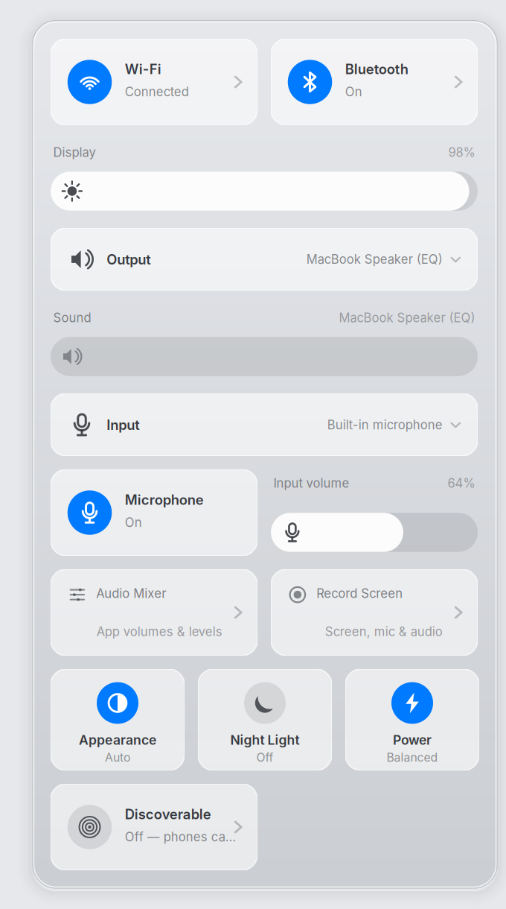

# Screen recording and microphone controls

Open **Record Screen** from Control Center, search for it with **Cmd+Space**, or
press **Cmd+Shift+R**. OBS opens with a screen source already fitted to the canvas
and two clearly named mixer channels: **Microphone** and **Computer audio**.

1. Check that the Microphone meter moves when you speak. Use Control Center's
   **Input** menu to choose the microphone, **Microphone** to mute/unmute, and
   **Input volume** to adjust sensitivity. Changing volume preserves mute.
2. Click **Start Recording**. Minimize OBS to keep it out of the picture.
3. Restore OBS and click **Stop Recording**. **Ctrl+Shift+F9** starts and **Ctrl+Shift+F10** stops
   recording while OBS is running (the Mac keyboard may require Fn).
4. Search **Open Recordings**, or use the Record Screen app's launcher action.
   Files are in **~/Videos/Recordings**.

The preset captures an entire monitor, including the pointer. OBS's Sources
**+ → Window Capture (Xcomposite)** can capture a particular app instead; hide
Entire screen using its eye icon when doing that. Source transforms are locked
initially so an accidental drag cannot move the screen out of frame.

<picture>
  <source media="(prefers-color-scheme: dark)" srcset="images/recording-controls-dark.png">
  
</picture>

## Audio that is easy to understand

**Audio Mixer** in Control Center opens pavucontrol. **Input Devices** has a live
microphone meter and port controls; **Recording** chooses a running recording
app's input; **Playback** adjusts individual applications; **Output Devices**
selects speakers/headphones. Streams appear when an app is using audio.

The Input menu excludes playback monitors and moves existing microphone clients
to the chosen input. It leaves desktop-monitor recording and the speaker EQ DSP
links alone. OBS follows the default mic and default output. Use the tuned
**MacBook Speaker (EQ)** output, never the raw speaker device. Headphones help
keep speaker audio from being picked up by the microphone a second time.

Track 1 contains the mix and plays normally. Track 2 is microphone only; track 3
is computer audio only, for adjusting them independently in an editor. Muting an
OBS mixer channel affects the recording; muting Microphone in Control Center
mutes the device for all apps. Audio monitoring is off, avoiding microphone
feedback. Neither opening the recorder nor installing it starts a recording.

## Smooth recording on the MacBook

The stock Ubuntu `i965-va-driver` advertises H.264 encoding but lacks the encoder
shaders; a real encode fails even though OBS offers VA-API. For this Broadwell
machine, the optional helper downloads Ubuntu's `i965-va-driver-shaders` through
APT, extracts it into a user directory, and verifies a synthetic encode before
installing it. It leaves the system graphics driver unchanged:

```bash
bin/recording-vaapi-install
```

Only **Record Screen** supplies this private driver to OBS. Other applications
keep their existing graphics environment. New Mintbook Recording profiles use
hardware encoding when that verified driver exists. The preset uses the Intel
encoder’s faster quality setting (`quality=7`) and 24 fps to leave headroom for
the desktop. Existing customized profiles are retained; in OBS Settings → Output, select Advanced recording and FFmpeg VAAPI
H.264 if upgrading an existing software profile. To undo, select software x264
before removing `~/.local/share/mintbook/recording/vaapi`. Licensing and package
version are retained beside the driver; no driver binary is stored in Git.

Minimize OBS after starting to avoid capturing the preview recursively and to
reduce rendering work. Check OBS's status bar for dropped frames under heavy load.

## Preset and installation

```bash
bin/setup --install-deps    # includes obs-studio and pavucontrol
bin/recording-install      # add controls to an existing desktop
```

The dedicated **Mintbook Recording** profile/scene collection is created only
when missing. Reruns retain OBS customizations and existing profiles. Initial
canvas size follows the first monitor; output keeps its aspect ratio and fits
within 1280×800 at 24 fps. Low-CPU x264 is the compatible software fallback.
The optional verified Intel encoder uses VA-API H.264 with constant quality (QP 23), freeing the fanless Core M
from software video compression. OBS Settings → Video can adjust resolution
after changing displays.

OBS records recoverable MKV files, then automatically remuxes a shareable MP4
without re-encoding. The MKV remains as the recovery/editing original. Allow
remuxing to finish before opening the MP4. WebSocket control is not enabled by
this setup. No extra resident service or background microphone recorder is added.
Control Center refreshes audio state only while open.

Installation uses the existing desktop release transaction and retains a
first-install backup of replaced files and the Cmd+Shift+R binding. Undo:

```bash
bin/recording-install --revert
```

This restores controls, launcher and shortcut; it retains OBS profiles and
recordings. The desktop release can also be rolled back with
`~/.local/bin/desktop-install --rollback`.

## Verification (2026-11-09)

Installed and exercised on the MacBook’s 2304×1440 display in both appearances.
A 10.374-second recording produced H.264 at 1280×800/24 fps and three AAC tracks,
with automatic MP4 remux. OBS reported 249 output frames, 252 drawn frames, and
no rendering- or encoding-lag warning. These are short smoke-test results under
the current workload, not a guarantee under every application load. Popup timing
was 474 ms warm (14 tiles); a cold open during tests took 1272 ms.
All 455 tests passed, along with syntax, palette and desktop-launcher checks. A
quiet synthetic playback test produced non-silent computer audio while the
microphone track remained separate. Tests cover preset preservation, track
routing, source selection, and preserving
mute when changing input volume. No sample containing desktop content or
microphone audio is committed.
