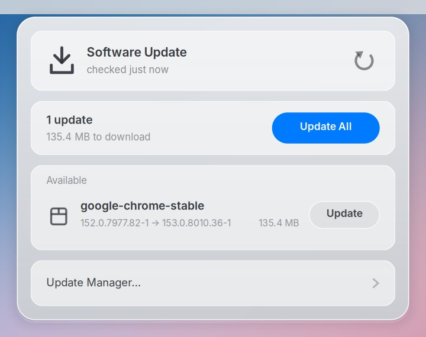

# Software updates — the icon that is only there when it needs to be

<p align="center">
  
</p>

Linux Mint ships a very good Update Manager. It is a window, and it lives in
the systray as an icon that is always present, always the same, and says what
it has to say in a tooltip. macOS puts the same information in two places
instead: a badge that appears when there is something to do, and a pane you
open to do it.

This is that split.

```
bin/updates-install            # plugin-20 on the bar, and the timer
bin/updates-install --revert   # both off; nothing installed is removed
```

Mint's Update Manager is still one click away in the popup's footer — it is
where the things a popup should not try to be live: update history, the kernel
list, sources, automation, the blacklist. Its session autostart is disabled by
a user override so its stock XApp icon does not duplicate this one; the program
and all of its settings remain installed and available on demand.

---

## The four pieces

| | what it is | what it costs |
|---|---|---|
| [`bin/updates-check`](../bin/updates-check) | reads the APT cache, asks flathub, writes two files | **2.5 s of CPU + ~2.5 s of network** |
| [`bin/panel-updates`](../bin/panel-updates) | the bar icon; reads one of those files | **6 ms**, every 5 min |
| [`bin/updates-menu`](../bin/updates-menu) | the glass popup | 300 ms to open |
| `mintbook-updates-check.timer` | runs the check 5 min after login, then every 6 h | |

The whole design is that ratio. Working out what apt has waiting means loading
the package cache and running a dist-upgrade resolution, which is two and a
half seconds of a fanless Core M; asking flathub what is new is another two
and a half seconds of waiting on a network. Together that is roughly a
thousand times what a bar indicator can spend. So the indicator never asks. It
reads

```
~/.cache/mintbook/updates.state     count = 4, security = 1, flatpak = 2, …
~/.cache/mintbook/updates.json      the list, for the popup
```

and draws a conclusion. A timer keeps those two honest, the popup re-runs the
check every time it opens, and `bin/doctor` is what tells you if the timer has
stopped — see [Staleness](#staleness).

`updates.state` is `key = value` lines because both of its readers are bash:
the genmon script and the Control Center tile. It is the same format the
Control Center plugins already speak. Both files are written with a rename, so
a popup reading while the check writes never sees half a file.

### It does not decide what an update is

`bin/updates-check` imports `checkAPT.APTCheck` out of
`/usr/lib/linuxmint/mintUpdate` — the same class behind `mintupdate-cli list`
and the Update Manager window. Packages are grouped into one update, named,
typed (`security` / `kernel` / `package`), described and aliased exactly the
way the Update Manager does it, and `/etc/mintupdate.blacklist` is honoured, so
an update ignored there is ignored here too.

Writing that against python-apt directly would have been a second opinion about
what an update is, and two opinions on one bar is one too many.

### apt is local; flatpak is not

The two halves of `updates-check` behave differently on purpose, and the
difference is the only interesting thing about the flatpak support.

**apt** never touches the network. Everything it needs is the package cache
already on disk, so it is the same answer whether you are on wifi, tethered or
on a train.

**flatpak** has no such cache. `list_installed_refs_for_update()` — the same
question `flatpak update` asks — is a round trip to flathub. So:

- it is skipped when NetworkManager's cached `Connectivity` property says
  there is no route out. That property costs 15 ms; `CheckConnectivity()` goes
  and asks the network, and is not used here for the same reason
  [`bin/panel-wifi`](../bin/panel-wifi) does not use it.
- **a skipped or failed flatpak check keeps the previous answer and the
  previous timestamp.** It does not write a zero. An empty list because we
  could not look is not the same fact as an empty list because there is
  nothing there, and the one thing this indicator must never do is report the
  first as the second.
- `updates.json` therefore carries `flatpak_checked` and `flatpak_error`
  alongside `checked` and `error`, and the popup shows an amber line when the
  flatpak half is stale, errored, or has never run. `bin/doctor` says the same
  thing in words.
- `bin/updates-check --no-net` forces the skip, for when you want the apt
  answer and nothing else.

Sizes are a second round trip each — about half a second per ref — so they run
against a six-second budget and any rows past it honestly report `0` rather
than making the whole check take a minute.

**A flatpak row has no "new version".** A `FlatpakRemoteRef` carries a commit
and two sizes, not appdata, so the version on the far side is not knowable
without pulling and parsing the remote's appstream. The row shows what you
have and where it comes from — `1.2.0 · flathub · user` — rather than an arrow
pointing at a blank. Apps get their appdata name; runtimes and extensions keep
their ref name, because that is what `flatpak update` calls them.

---

## The icon is not always there

When nothing is waiting, `bin/panel-updates` prints a **transparent** icon and
the indicator disappears. That is the same rule the Control Center plugins
follow — *say nothing rather than show a dead switch* — and it is why the bar
is quiet almost all of the time.

Transparent, rather than nothing at all, because genmon has no way of being
told to draw nothing — see the gotcha at the bottom. It cost one shipped bug.

It sits **to the left of the CPU sparkline**, and that position is the whole
reason it can afford to come and go. The bar is packed against the right edge,
so an item added at the left end of the group grows the group leftward and
nothing already on it moves. Anywhere further right, every appearance and
disappearance of this icon would have shuffled the clock.

Two states:

| | when |
|---|---|
| `updates-none.svg`, one transparent pixel | nothing is waiting |
| the plain arrow | ordinary package updates |
| the arrow with a dot beside it | there is a **security** or **kernel** update in there |

Nothing shouts about a translation package. A bar that raises its voice for
everything is a bar you stop reading.

The tooltip carries the rest: the count, the total download, the breakdown and
when the answer was last checked.

### So where is the door when the icon is gone?

The Control Center, after Power: an **Updates** tile that is always present,
reads the same state file, and opens the popup from its `›`. That tile is
`control-center/plugins/70-updates`, twelve lines of bash, and it is the reason
hiding the bar icon is not a trap.

---

## What the popup can do

- **Update All** — the blue one. Everything on the list.
- **Update**, per row — one update, on its own. Security first, then kernel,
  then alphabetical; the order comes out of `updates-check`, so the popup and
  the file on disk cannot drift.
- **The circular arrow, top right** — refresh the package lists and check again.
- **Update Manager…** — Mint's window, for everything else.

Six rows fit; a longer list scrolls under the pointer and says `1–6 of 9`.

### Two backends, one after the other

A selection can contain both kinds. `install()` splits it and runs **apt
first, then flatpak** — a kernel or a library is the half other things depend
on, and a failure there is a reason not to start the second half at all.
`self.queue` is that running order and `next_phase()` walks it. Every selected
row spins for the whole job rather than only during its own phase: they are
all queued, and a row sitting inert for two minutes while apt works looks like
a row that was ignored.

Flatpak updates go through Flatpak's own `Transaction`, in a thread, with
progress marshalled back through `GLib.idle_add` and a `Gio.Cancellable`
behind the Cancel button. **A user-scope flatpak update needs no password at
all** — the files belong to you — so on this machine, where both apps are user
installs, that phase is a progress bar and no prompt. A system-scope one goes
through flatpak's own polkit action.

Driven end to end on 2026-09-07, against a real out-of-date ref: the operation
name, the delta progress and flatpak's own detail line (*1 delta parts, 3
loose fetched; 75 KiB transferred in 1 sec*) all arrive and are drawn, the row
takes a green tick, and the re-check follows. No prompt, as expected for a
user install.

### The privileged half is aptkit, not us

Nothing in mintbook runs as root to do this. Installing goes through
**aptkit** — the same backend the Update Manager uses, the same
`org.aptkit.install-or-remove-packages` polkit action, the same daemon doing
the dpkg run. The popup is a client of it: it gets the status, the progress and
the failure back over D-Bus and draws them in its own row.

Two consequences worth knowing:

- **The apt transaction outlives the popup window.** It runs in aptkit's
  daemon, while the popup process stays alive to retain progress and to run a
  queued Flatpak phase. Clicking the bar icon during an install hides the
  window; clicking it again reopens the same process at the same progress.
- **Refreshing the lists costs no password.** `org.aptkit.update-cache` is
  `allow_active=yes`. Installing is `auth_admin_keep`, so that one asks — once,
  and then not again for a few minutes.

### It lets go of the seat to let you type

The popup holds a pointer grab, which is how a click outside dismisses it. The
polkit agent needs the **keyboard** to ask for a password, and an override
redirect window holding the seat leaves that dialog unable to take a single
keystroke.

So the grab is dropped the moment a transaction starts and taken again when it
ends. While an install runs, clicking outside does nothing. Clicking the bar
icon deliberately hides the popup without ending its process or transaction;
clicking again restores the live progress view.

### What it asks before it installs

Before aptkit is called at all, python-apt resolves the request against the
same cache: mark the packages, take `cache.get_changes()`, and see what else
that drags in. If anything would be **newly installed** or **removed**, the
popup says so and waits, with the removals in red.

That resolution is a plain read of files this user can already read, and it
happens *before* the password prompt rather than after it — which is the point.
Being told what a click entails is worth less once you have already typed your
password for it.

It is also why `simulate()` is never called on the transaction: apt's resolver
has already answered, and asking a second resolver only buys a second answer to
compare against.

### What it says when it does not work

| | shown as |
|---|---|
| you dismissed the password prompt | *Not authorised*, in plain ink |
| you pressed Cancel | *Cancelled*, in plain ink |
| dpkg failed | the first line of aptkit's error, red |
| a repository failed to refresh | amber, and the check still runs |

A dismissed password prompt arrives from aptkit as
`org.freedesktop.PolicyKit.Error.NotAuthorized`. Putting that string on screen
under a red dot calls the user's own "no" a fault, so `humanise()` in
`bin/updates-menu` is the one place raw D-Bus errors are turned into a line.

A kernel update that installs adds `· restart to finish the kernel` to the
success line, in amber.

---

## Staleness

Every check above can be green while the answer on the bar is a week old, and
a stale *"nothing waiting"* is precisely the lie this indicator exists to
avoid — the same failure the Wi-Fi icon had when it drew three full bars over
a dead uplink.

The bar itself does not police this, on purpose: an icon that appears to nag
about its own timer is worse than the problem. `bin/doctor` does:

```
  ok    updates state    1 waiting (0 security), checked 1h ago
```

and it warns past 18 hours, which is three missed runs of a 6-hour timer. The
popup's header carries the same fact in words — *checked 2 hours ago* — every
time you open it.

The flatpak half gets its own line, because it can be stale on its own:

```
  ok    flatpak updates  0 waiting, asked 1h ago
  warn  flatpak updates  2 waiting, but last asked 73h ago — offline since?
```

A machine that has been off the network for three days has a perfectly fresh
apt answer and a three-day-old flatpak answer sitting in the same file, and
the bar's tooltip appends `· flatpaks 3d ago` once the two are more than a day
apart. That is the whole reason the carry-forward exists.

---

## What this does not do

- **Tell you a flatpak's new version number.** It shows the one you have. See
  above for why the other one is not cheaply knowable.
- **Group a flatpak's runtimes under the app that needs them.** The Update
  Manager does; here `org.freedesktop.Platform.GL.default` gets its own row,
  the way `flatpak update` lists it. Honest, and one less thing to be wrong
  about.
- **Cinnamon spices.** Not applicable — this is XFCE.
- **Automatic installs.** Nothing here installs anything you did not press a
  button for. Mint's `mintupdate-automation` is untouched and, if you want it,
  it is behind the Update Manager's own preferences.
- **A confirmation for the ordinary case.** If a click pulls in nothing new and
  removes nothing, it goes straight to the password prompt. The prompt *is* the
  confirmation.

---

## Cost, measured

`bin/panel-updates`, 20 runs, on 2026-09-07:

```
20 invocations, 0.128 s total → 6.4 ms each
```

At the rc's 300 s period that is 0.002% of a core — the cheapest thing on the
bar by a factor of ten, and it stays that way because it never grows a second
job. Compare `panel-cpu` at 46.7 ms every 2 s (2.34%) and `panel-wifi` at
29.7 ms every 5 s (0.59%); see [control-center.md](control-center.md).

`bin/updates-check`, the expensive half, on a busy machine: **2.5–3.0 s** for
apt across the runs measured here, of which nearly all is `apt.Cache()` and
the dist-upgrade resolution, plus **~2.5 s** of waiting on flathub for the
flatpak half — waiting, not CPU. Four runs a day is about 11 seconds of CPU
and four network round trips.

Opening the popup: the cached list is drawn immediately and the re-check runs
behind it, the same way `bin/wifi-menu` shows the cached scan and rescans
behind it. The check is spawned on the first line of the file, *before*
`import gi`, so the ~220 ms GTK import happens inside it for free.

---

## Undo

```bash
bin/updates-install --revert
```

Takes plugin-20 off the bar, disables the timer, and removes the three scripts,
the Control Center tile and the icons. It also restores the Mint Update Manager
autostart state that existed before installation. `plugin-20` stays registered
but unused; the cached list in `~/.cache/mintbook/updates.json` is left alone.
Nothing installed by apt is touched, and `mintupdate` still opens the window it
always did.

---

## How the flatpak path got tested

There was nothing out of date on this machine, and shipping a second install
backend that had never installed anything was not worth doing twice in one
day. So the state was manufactured: install a small app, roll it back a
commit, let the popup update it, remove it again.

Two things went wrong doing that, both worth keeping:

- **The old commit needed an old runtime.** `com.github.tchx84.Flatseal` is
  930 kB and its *current* build runs on `org.gnome.Platform//50`, which was
  already here. The September 2025 build does not — it wants `//49`, and
  downgrading pulled 1.1 GB of runtime down with it. The size of a flatpak
  says nothing about the size of installing an old one.
- **`flatpak uninstall --unused` is broader than "what I just added".** It
  removed `org.freedesktop.Platform.codecs-extra`, which had been installed
  all along and had simply stopped being referenced once the test app went.
  It was reinstalled. `--unused` answers "is anything pointing at this now",
  not "did you put this here", and those are different questions on a machine
  where an app was uninstalled at any point in the past.

The end state is byte-for-byte the list that was there before, which is the
only reason this was worth doing at all.

---

## Gotchas

- **genmon cannot be told to draw nothing.** Given output with no `<txt>` and
  no `` in it, it falls back to putting the whole of stdout on the bar as
  a label — so the first version of `panel-updates`, which printed only its
  `<click>` tags when there was nothing to report, put
  `<click>/home/cobo/.local/bin/updates-menu</click>` across the panel in plain
  text. It shipped that way and was caught the first time the machine actually
  had nothing waiting, which is the one state that had never been on the bar
  during development: every screenshot until then was taken with an update
  pending. An empty `<txt></txt>` does not help either — tested, same fallback.
  The fix is `updates-none.svg`, one transparent pixel, 34 high. Not zero-width:
  a zero-width SVG is not guaranteed to load, and a loader that refuses it puts
  us straight back to stdout on the bar.
- **Flatpak's status line is a ref, not a name.** `operation.get_ref()` gives
  `app/com.github.tchx84.Flatseal/x86_64/stable`, and the first version put
  the middle of that on screen above a row labelled *Flatseal*. The installer
  carries a ref→name map now, falling back to the ref for a dependency that
  was never in the list.
- **A local `failures = []` inside the worker silently ate every flatpak
  error.** `operation-error` is a signal: it fires on the transaction and
  appends to the closure's list, while the thread function had declared a list
  of its own with the same name. The result was a job that reported success no
  matter what went wrong inside it. Caught by reading it back rather than by
  running it, because there is nothing on this machine to fail yet.
- **`trans.run(error_handler=…)` alone raises.** aptkit's `MissingReplyHandlerException`
  says *"if you define an error_handler you must also define a reply_handler"* —
  and it comes out of `run()` rather than reaching the handler you did give it,
  so the first version failed silently before any transaction ever started. Both
  handlers or neither.
- **A finished transaction keeps emitting for a moment.** The refresh
  transaction's last `status-changed` landed in the header while an install was
  already preparing, so the popup said *"Loading software list"* over a progress
  bar for a package install. Every handler now ignores anything that is not the
  current transaction.
- **`pkill -f updates-menu` kills the shell that ran it.** `-f` matches full
  command lines, and the command line containing the pattern includes the one
  doing the matching. Cost two confusing exit-144s. The pidfile is there for
  exactly this; use it.
- **`progress` can be 101.** aptkit's way of saying it has no idea. The bar
  draws a sliding lozenge for anything over 100, because a progress bar frozen
  at 0 while dpkg works looks like a hang.
- **The refresh button surfaces a repository that has been broken for a while.**
  The first press on this machine came back amber: a third-party apt source
  whose signing key is not installed. apt goes on with every list it *did* get,
  which is why nothing had ever mentioned it. That is the check working, not
  the popup failing — but it does mean the amber line is a thing you will see
  and have to decide about rather than a rare event.
